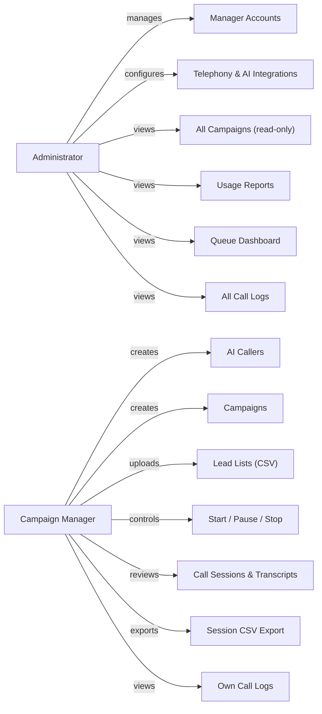

# Platform Overview

This document provides a product-level understanding of the CPB AI Calling Agent Manager — what it does, who uses it, and what features are available. Read this first before diving into architecture or code.

---

## Purpose

The platform automates outbound phone calls using AI. A campaign manager uploads a list of leads, configures an AI caller persona, and launches a campaign. The system autonomously dials each lead, conducts a real-time conversation using Google Gemini Live, and extracts structured data from the call transcript (intent, interest level, callback requests, objections). The entire process — from dialing to data extraction — runs without human intervention.

The platform is designed for sales teams, customer outreach operations, and any use case where thousands of phone conversations need to happen at scale with consistent messaging.

---

## User Roles

The platform supports two roles with strict access separation.

### Administrator

Full system access. Responsible for platform configuration, user management, and operational oversight. Administrators are not subject to call or minute limits.

### Campaign Manager

Scoped to their own data. Campaign managers create AI callers, build campaigns, upload leads, control campaign execution, and review call outcomes. Each manager account has configurable limits on total calls and total minutes (set by the administrator). A limit value of `0` means unlimited.

---

## Core Product Concepts

### AI Callers

An AI Caller is a configured persona that the AI uses during phone conversations. Each caller includes:

- **System prompt**: The core instruction set that defines the AI's personality, objectives, and conversational style.
- **Voice**: The Gemini Live voice model (e.g., `Kore`).
- **Model**: The Gemini model variant (e.g., `gemini-3.8-live`).
- **Guardrails**: Safety limits including maximum call duration (seconds) and silence timeout (seconds).
- **Q&A entries**: Up to 20 question-answer pairs injected into the AI's context as FAQ knowledge.
- **Knowledge base links**: References to uploaded knowledge documents (backend wired, frontend UI not yet available).
- **Telephony caller ID**: The outbound phone number displayed to leads.

The AI Caller's system prompt is the primary mechanism for controlling call behavior at runtime. The platform also includes a visual Script Builder UI that stores node graphs, but its runtime execution is unverified — see [Known Gaps](12-known-gaps.md) for details.

### Campaigns

A campaign binds an AI Caller to a list of leads and defines the calling rules:

- **Concurrency limit**: Maximum simultaneous calls (1–50, default 5).
- **Max call duration**: Per-call time limit (30–600 seconds, default 180).
- **Retry settings**: Retry gap (minutes between retries, default 120), max retries (1–10, default 3), retry mode (`queue_tail` or `backoff`).
- **Calling window**: Time-of-day restrictions with timezone and day-of-week rules (e.g., Monday–Friday 9:00–18:00 IST).

Campaigns move through a defined lifecycle. See [Data Model](05-data-model.md) for the complete state machine.

| Transition | Trigger |
|-----------|---------|
| `draft` → `running` | Manager clicks Start (requires leads, limits not exceeded) |
| `running` → `paused` | Manager clicks Pause |
| `running` → `stopped` | Manager clicks Stop (permanent, requires confirmation) |
| `running` → `completed` | All leads reach terminal state (automatic) |
| `paused` → `running` | Manager clicks Start again |
| `paused` → `stopped` | Manager clicks Stop |

Once a campaign reaches `stopped` or `completed`, it is permanently terminal. The backend rejects any attempt to restart it.

### Leads

Leads are the people the system calls. They are uploaded to a campaign via CSV (up to 50MB) with a column-mapping UI that maps CSV headers to campaign fields. Each lead tracks:

- Contact information (name, phone, email, custom fields)
- Call status (`pending` → `calling` → `completed` / `exhausted` / `no_answer`)
- Retry state (retry count, next retry time, last called time)

### Call Sessions

A Call Session is the permanent record of a single call attempt. It captures:

- Full transcript (turn-by-turn with timestamps)
- AI-extracted structured data (intent, interest level, callback requested, objections, next step, notes)
- Call outcome (`answered`, `voicemail`, `no_answer`, `busy`, `failed`, etc.)
- Duration, timing data, token usage, and estimated cost
- Bridge performance metrics

Call sessions are the primary data asset — they are what campaign managers use to evaluate leads and what the extraction pipeline processes.

---

## Administrator Capabilities

| Feature | Status | Frontend Page | Backend Route |
|---------|--------|--------------|---------------|
| Manager account CRUD | Fully implemented | `/admin/managers` | `POST/GET/PUT/DELETE /api/admin/managers` |
| Integration management (Gemini + Telephony) | Fully implemented | `/admin/integrations` | `CRUD /api/integrations` |
| System-wide campaign view | Fully implemented | `/admin/campaigns` | `GET /api/campaigns/admin/all` |
| System-wide call logs | Fully implemented | `/admin/logs` | `GET /api/call-logs` |
| Usage reports | Fully implemented | `/admin/reports` | `GET /api/admin/reports/usage` |
| Queue dashboard | Fully implemented | `/admin/queue` | `GET /api/dial-queue/*` |
| Telephony settings (legacy) | Partially implemented | `/admin/telephony` | `GET/POST /api/telephony/config` |

**Integration management** is the primary admin configuration task. Administrators configure two types of integrations:

- **`s2s` (Server-to-Server)**: A Google Gemini Live API key used by the AI bridge for real-time speech.
- **`telephony`**: Vobiz or Twilio credentials (provider, API keys, caller IDs) used for outbound calling.

A single integration per type can be marked as the default. When an AI Caller does not specify an explicit integration, the system uses the default.

**Telephony Settings** is a legacy configuration page. The active call pipeline reads telephony configuration from `Integration` records, not from the `TelephonyConfig` model that this page writes to. The page may appear functional but has no effect on actual calls — see [Known Gaps](12-known-gaps.md).

---

## Campaign Manager Capabilities

| Feature | Status | Frontend Page | Backend Route |
|---------|--------|--------------|---------------|
| AI Caller CRUD | Fully implemented | `/cm/callers` | `CRUD /api/callers` |
| Script Builder | Partially implemented | `/cm/callers/:callerId/script` | Stored in `AICaller.scriptFlow` |
| Campaign CRUD + lifecycle | Fully implemented | `/cm/campaigns`, `/cm/campaigns/:id` | `CRUD + lifecycle /api/campaigns` |
| Lead management + CSV upload | Fully implemented | Inside campaign pages | `CRUD /api/campaigns/:id/leads` |
| Session monitoring | Fully implemented | `/cm/campaigns/:id/sessions` | `GET /api/campaigns/:id/sessions` |
| Session CSV export | Fully implemented | Download link | `GET /api/campaigns/:id/sessions/export` |
| Call logs | Fully implemented | `/cm/logs` | `GET /api/call-logs` |
| Knowledge base management | Backend only | No frontend page | `CRUD /api/knowledge` |

---

## Feature Status Inventory

| Feature | Status | Notes |
|---------|--------|-------|
| Outbound AI calling (Vobiz) | Fully implemented | Active production path |
| Outbound AI calling (Twilio) | Fully implemented | Secondary provider, same bridge architecture |
| Campaign lifecycle management | Fully implemented | Start, pause, stop, auto-complete |
| Lead CSV upload with column mapping | Fully implemented | 50MB limit via multer |
| Post-call transcript extraction | Fully implemented | Gemini 2.5 Flash for structured data extraction |
| Retry logic (queue tail + backoff) | Fully implemented | Configurable per campaign |
| Calling window enforcement | Fully implemented | Timezone-aware, day-of-week rules |
| Boot-time extraction recovery | Fully implemented | Recovers up to 50 missed extractions per restart |
| CDR poll fallback | Fully implemented | Recovers sessions with missed hangup webhooks |
| Answering machine detection | Fully implemented | Gemini-based detection + Twilio AMD |
| Dual transcription (Gemini + Deepgram) | Fully implemented | Deepgram for Hinglish, Gemini as fallback |
| Script flow runtime execution | Unverified | UI exists, no evidence of runtime use in bridge |
| Knowledge base UI | Missing | Backend wired, no campaign manager frontend page |
| Deepgram-only transcription | Not active | System uses Gemini native STT exclusively when Deepgram key not set |
| S2S-to-S2S call transfer | Not implemented | No code path found |
| Webhook signature verification | Not implemented | All webhook endpoints are public |
| Structured logging / alerting | Not implemented | Raw console output captured by PM2 |

For a detailed breakdown of each gap, see [Known Gaps](12-known-gaps.md).
