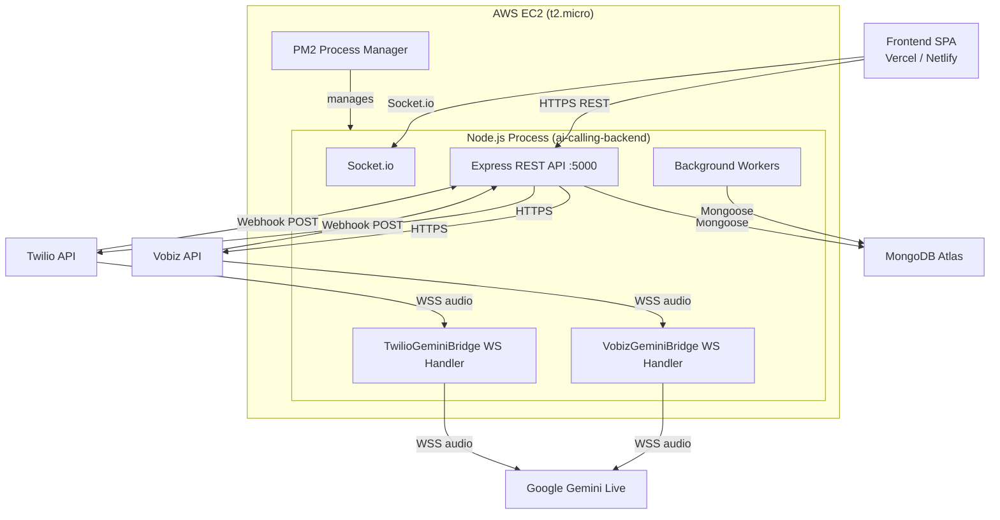
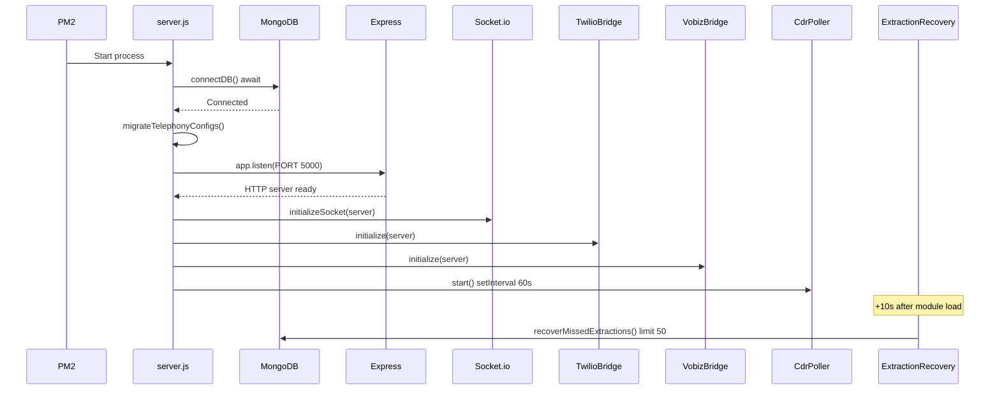

# System Architecture

This document describes how the CPB AI Calling Agent Manager is deployed, what processes run, how they communicate, and why the system is designed the way it is. Read this after [Platform Overview](01-platform-overview.md) and before diving into any subsystem.

---

## Deployment Topology

The platform runs as a single Node.js process on an AWS EC2 instance, communicating with MongoDB Atlas for persistence, Google Gemini Live for AI speech, and Vobiz (or Twilio) for telephony. The frontend is a static React SPA deployed separately.

All backend components — the REST API, the WebSocket bridge handlers, Socket.io, and all background workers — share a single Node.js process managed by PM2. There is no separate worker process, no Redis, no BullMQ, and no external job queue.

---

## Single-Process Architecture

This is the most important architectural decision to understand. Every component runs in one OS process:

- **Express REST API**: Handles all CRUD operations, campaign control, and webhook receipt.
- **WebSocket bridge handlers**: Accept audio streams from Vobiz/Twilio and relay them to/from Gemini Live.
- **Background workers**: Poll MongoDB for jobs, initiate calls, and process post-call extractions.
- **Socket.io**: Pushes real-time updates to the frontend.

### Why This Design

Operational simplicity. The platform runs on a single small EC2 instance. A multi-process architecture with Redis and BullMQ would add infrastructure complexity, operational burden, and cost without proportional benefit at the current scale.

### Consequences

1. **PM2 restart loses all in-memory state.** The `activeCampaigns` Maps in `CampaignAutodialerService` and `DialQueueWorker` are cleared. Campaigns with `status: 'running'` in MongoDB have no active workers after a restart — operators must manually click Start on each campaign to resume dialing.

2. **The in-memory extraction queue is lost on restart.** Mitigated by the boot-time `recoverMissedExtractions` scan, which recovers up to 50 unprocessed sessions from MongoDB 10 seconds after startup.

3. **CPU-intensive operations block everything.** Since there is no threading or worker-process isolation, a heavy database scan or a burst of concurrent WebSocket activity can temporarily starve the REST API. The boot-time extraction recovery limit was reduced to 50 sessions specifically to prevent this.

---

## Transport Layers

The backend exposes four distinct transport interfaces, all sharing a single HTTP server on port 5000.

### REST API (`/api/*`)

Standard Express HTTP request/response for all CRUD operations, campaign lifecycle control, and webhook receipt from telephony providers. Protected routes require a JWT in the `Authorization: Bearer <token>` header.

### WebSocket — Telephony Bridges

Two WebSocket upgrade handlers are registered on the same HTTP server:

- **Vobiz bridge**: Intercepts upgrades to `/api/telephony/vobiz/media-stream` — receives raw μ-law audio from Vobiz and relays it to Gemini Live.
- **Twilio bridge**: Intercepts upgrades to the Twilio media stream path — same pattern, different audio encoding.

These WebSocket connections carry real-time audio. Each active call maintains two WebSocket connections: one from the telephony provider to the backend, and one from the backend to Gemini Live. The bridge transcodes audio bidirectionally between them. See [Vobiz-Gemini Bridge](08-vobiz-gemini-bridge.md) for the complete deep dive.

### WebSocket — Gemini Live

Outbound WebSocket connections to `wss://generativelanguage.googleapis.com/ws/...BidiGenerateContent`. Each active call gets its own dedicated Gemini WebSocket for bidirectional audio and text. These connections are established during the pre-warm phase (before the lead even picks up) so that when the lead answers, the AI responds with zero latency.

### Socket.io

Attached to the same HTTP server. Used exclusively by the frontend to receive real-time updates (call status changes, session events). Not used for any telephony or AI communication.

---

## Background Workers

All background processing runs inside the main Node.js process as `setInterval` or `setTimeout` loops. None of these workers survive a process restart.

| Worker | Trigger | Interval | What It Does | Survives Restart? |
|--------|---------|----------|-------------|-------------------|
| **DialQueueWorker** | `startCampaignWorker()` | 1 second per campaign | Claims jobs from MongoDB and initiates outbound calls | No — must be manually restarted via campaign Start |
| **CampaignAutodialerService** | `start()` | 5 seconds per campaign | Monitors for new pending leads and re-enqueues them | No — same lifecycle as DialQueueWorker |
| **VobizCdrPoller** | Server startup | 60 seconds | Polls Vobiz CDR API to recover sessions with missed hangup webhooks | Yes — auto-starts on every boot |
| **ExtractionQueue** | `pushToExtractionQueue()` | Serial, on-demand | Sends completed transcripts to Gemini for structured extraction | Queue lost on restart; 50 sessions recovered from DB on boot |

The `DialQueueWorker` is the heart of the system. It runs a 1-second `setInterval` for each active campaign, claiming available jobs from the `DialQueueJob` collection via atomic MongoDB `findOneAndUpdate` operations and firing call executions asynchronously. Multiple calls run concurrently within the same process. See [Dial Queue System](07-dial-queue-system.md) for the complete architecture.

---

## External System Boundaries

| System | Direction | Protocol | Purpose |
|--------|-----------|----------|---------|
| Vobiz | Outbound (API) | HTTPS | Initiate outbound calls, force hangup |
| Vobiz | Inbound (webhook) | HTTPS POST | Answer URL, Hangup URL, Stream Status |
| Vobiz | Inbound (WebSocket) | WSS | Real-time audio stream during active calls |
| Vobiz | Outbound (poll) | HTTPS GET | CDR polling fallback for missed webhooks |
| Twilio | Outbound (API) | HTTPS | Initiate outbound calls |
| Twilio | Inbound (webhook) | HTTPS POST | Voice (TwiML), Status callback, AMD callback |
| Twilio | Inbound (WebSocket) | WSS | Real-time audio stream during active calls |
| Gemini Live | Outbound (WebSocket) | WSS | Bidirectional audio + text AI conversation |
| Gemini (extraction) | Outbound (API) | HTTPS | Post-call structured data extraction |
| MongoDB Atlas | Outbound | TCP (Mongoose) | All persistence |

For detailed API contracts, webhook payloads, and failure handling per integration, see [Integrations](09-integrations.md).

---

## Critical Design Decisions

### Pre-warm Pattern

When the system initiates an outbound call, it does two things simultaneously:

1. **Tells Vobiz to dial the lead's phone number** (the phone starts ringing).
2. **Opens a WebSocket to Gemini Live** and sends the full system prompt, voice configuration, and AI tools.

By the time the lead picks up (typically 5–15 seconds later), the Gemini WebSocket is already connected, the AI context is loaded, and the greeting audio may already be buffered. When Vobiz's audio stream arrives, the bridge adopts the pre-warmed Gemini connection and begins relaying audio immediately — the AI speaks within milliseconds of answer.

The pre-warm slot is held for up to 5 minutes (`DEFAULT_PREWARM_TTL_MS`). If the lead never picks up, the Gemini connection is automatically closed and the concurrency slot is freed.

This pattern is critical for call quality. Without it, there would be a 2–5 second cold-start delay after the lead answers while the Gemini connection initializes, creating an awkward silence that causes leads to hang up.

### Timer Cascade

Three carefully aligned timers govern call lifecycle and prevent dead connections from consuming system resources:

```mermaid
gantt
    title Timer Cascade (per call)
    dateFormat X
    axisFormat %s

    section Pre-warm Phase
    Prewarm TTL (5 min)            :a1, 0, 300

    section Live Call Phase
    Hard Stop Timer (5 min)         :a2, 0, 300
    Silence Watchdog (30s rolling) :a3, 0, 30

    section Worker Lease
    DB Lease Timeout (5.5 min)     :a4, 0, 330
```

| Timer | Duration | Purpose |
|-------|----------|---------|
| **Prewarm TTL** | 5 minutes | Auto-closes the Gemini WebSocket if no audio stream arrives (lead never picks up) |
| **Hard Stop** | 5 minutes | Forces call termination regardless of conversation state — absolute ceiling |
| **Silence Watchdog** | 30 seconds rolling | Terminates call if neither party speaks for 30 seconds |
| **Worker Lease** | 5.5 minutes | Database lease on the `DialQueueJob` auto-expires, freeing the concurrency slot |

The 5.5-minute worker lease is intentionally 30 seconds longer than the 5-minute hard stop. This ensures that a legitimate call always completes and is acknowledged before its lease expires. If the bridge crashes without cleaning up, the lease expires after 5.5 minutes and the concurrency slot is automatically freed — no manual database intervention required.

This cascade is the system's primary defense against dead telecom sockets consuming concurrency slots indefinitely.

### CPU Credit Sensitivity

The backend runs on an AWS `t2.micro` instance with burstable CPU. The instance provides a baseline of 10% CPU utilization, accumulating credits during idle periods and spending them during bursts.

If the Node.js process sustains high CPU use — for example, a boot-time database scan running simultaneously with active WebSocket bridges — AWS throttles the instance to its baseline, which can make the system unresponsive and even prevent SSH access.

Mitigations in place:

- Boot-time extraction recovery is limited to 50 sessions (down from 5,000) to prevent CPU saturation during startup.
- Call concurrency is bounded per-campaign and globally (`MAX_GLOBAL_CONCURRENCY: 50`) to prevent unbounded resource consumption.
- PM2 is configured with `max_memory_restart: '1G'` to auto-restart the process if RAM exceeds 1GB.

### Dual Telephony Provider Support

The system is architected around an `Integration` model that supports both Vobiz and Twilio. When `s2sCallingService.initiateLeadCall()` needs to place a call, it reads the provider type from the `Integration` record associated with the AI Caller and branches between the Vobiz path (`vobizService` + `vobizGeminiBridge`) and the Twilio path (`twilioService` + `twilioGeminiBridge`).

In current production use, **Vobiz is the active provider**. The Twilio bridge follows the same architectural pattern and is fully implemented but is not the primary call path.

---

## Boot Sequence

When PM2 starts the backend process, the following initialization sequence executes:

**Step-by-step:**

1. **Load environment**: `dotenv/config` loads `.env` into `process.env`.
2. **Connect to MongoDB**: `connectDB()` establishes a Mongoose connection to MongoDB Atlas. This is awaited — the server does not start until the database is reachable.
3. **Run migration**: `migrateTelephonyConfigs()` is a one-shot migration utility. Errors are caught and are not fatal.
4. **Start HTTP server**: `app.listen(PORT)` — the Express server begins accepting connections on port 5000.
5. **Attach Socket.io**: `initializeSocket(server)` attaches the Socket.io server to the HTTP server.
6. **Register Twilio bridge**: `twilioGeminiBridge.initialize(server)` registers a WebSocket upgrade handler for Twilio media streams.
7. **Register Vobiz bridge**: `vobizGeminiBridge.initialize(server)` registers a WebSocket upgrade handler for Vobiz media streams.
8. **Start CDR poller**: `vobizCdrPoller.start()` begins a 60-second `setInterval` that polls Vobiz CDR records to recover missed hangup webhooks.
9. **Extraction recovery** (deferred): 10 seconds after the `callSessionService` module is first imported, `recoverMissedExtractions()` scans MongoDB for completed call sessions missing their extraction flag and re-injects up to 50 into the in-memory extraction queue.

After this sequence completes, the server is fully operational — but **no campaigns are actively dialing**. Campaign workers must be manually started by a user clicking Start on each campaign.

---

## Warm vs. Cold State After Restart

Understanding what persists across restarts and what is lost is critical for operating this system.

### Persisted (in MongoDB)

- All data: Users, Campaigns, Leads, CallSessions, DialQueueJobs, Integrations, AI Callers
- Campaign status (`running`, `paused`, etc.)
- Lead status and retry state
- DialQueueJob status and lease information
- Completed call transcripts and extracted data

### Lost (in-memory only)

- **Active campaign workers**: The `activeCampaigns` Maps in both `CampaignAutodialerService` and `DialQueueWorker` are empty after restart. Campaigns with `status: 'running'` in MongoDB are effectively stalled — their workers died with the process.
- **Extraction queue**: Any pending extractions in the in-memory queue are lost. The boot-time recovery mechanism (`recoverMissedExtractions`) recovers up to 50 on next startup.
- **Active WebSocket connections**: All Gemini and telephony audio streams are severed. In-progress calls are terminated.
- **In-process semaphore counters**: The global concurrency semaphore resets to 0.

### Recovery

- **Campaigns**: An operator must manually click Start on each campaign that was running before the restart. There is no automatic worker recovery — see [Known Gaps](12-known-gaps.md).
- **Claimed jobs**: DialQueueJobs in `claimed` status with expired leases are automatically released back to `waiting` by `_releaseExpiredLeases()` on the next worker tick. For up to 5.5 minutes after restart, these phantom claims may inflate the concurrency count and temporarily block new calls.
- **Extractions**: The 50-session boot-time recovery handles the most recent missed extractions. If more than 50 sessions were pending, additional restarts or manual intervention are needed.
