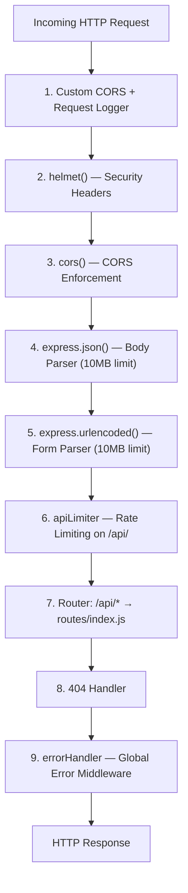
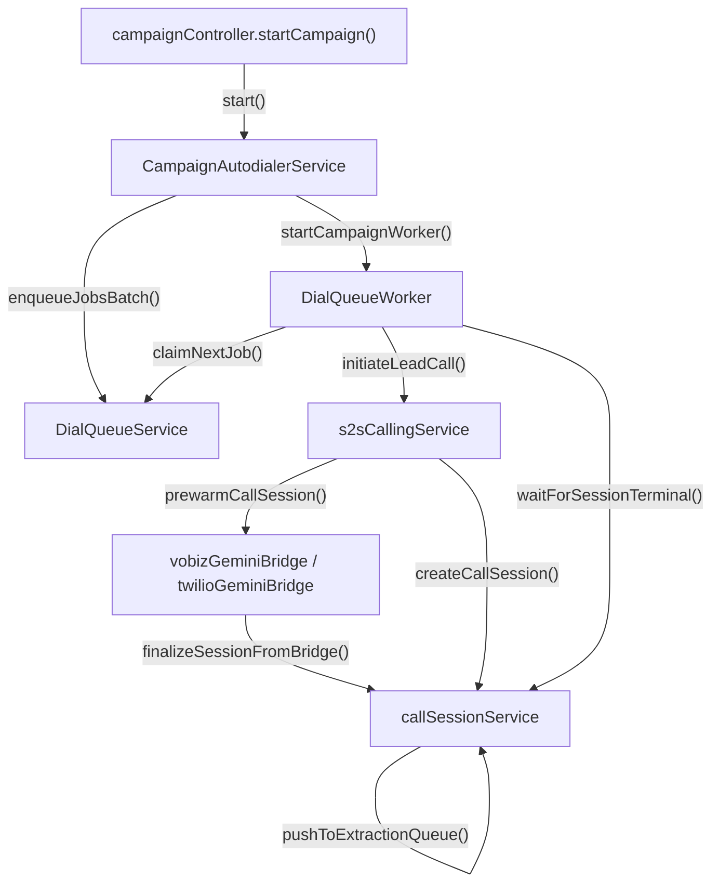

# Backend Architecture

This document describes the backend internals — how HTTP requests flow through the application, what each layer is responsible for, and how the major services interact. Read this after [System Architecture](02-system-architecture.md), which covers the high-level deployment topology and background worker design.

---

## Express Application Factory (`app.js`)

The Express application is constructed in `backend/src/app.js` and mounted by `server.js`. Every HTTP request passes through a strict middleware chain before reaching a route handler.

### Middleware Chain

Requests are processed in this exact order:



1. **Custom CORS + request logger**: A manual middleware that logs incoming request method, URL, and origin. Runs before the library CORS middleware.
2. **`helmet()`**: Sets standard security headers (`X-Content-Type-Options`, `X-Frame-Options`, `Strict-Transport-Security`, etc.).
3. **`cors()`**: Enforces CORS with an `allowedOrigins` list. The list includes `FRONTEND_URL` from the environment and any additional origins specified in `ALLOWED_ORIGINS` (comma-separated).
4. **`express.json({ limit: '10mb' })`**: Parses JSON request bodies up to 10MB. This is the limit for standard API requests.
5. **`express.urlencoded({ extended: true, limit: '10mb' })`**: Parses URL-encoded form bodies.
6. **`apiLimiter`**: An `express-rate-limit` instance applied to all `/api/` routes. Prevents abuse by limiting request frequency per IP.
7. **Router**: All `/api/*` requests are delegated to `routes/index.js`, which mounts the individual route files.
8. **404 handler**: Catches any request that did not match a route and returns a structured 404 response.
9. **`errorHandler`**: The global error-catching middleware. Must be registered last. See [Error Handling](#error-handling) below.

### Body Size Limits

Two different upload limits exist, and it is important to understand which applies where:

| Path | Parser | Limit | Why |
|------|--------|-------|-----|
| All `/api/*` routes | `express.json()` | 10MB | Standard JSON payloads (campaign creation, lead data, etc.) |
| `POST /api/campaigns/:id/leads/upload` | `multer` with `memoryStorage` | 50MB | CSV file uploads bypass the JSON parser entirely. The 50MB limit is defined in `routes/leads.js` using multer's `limits.fileSize` option. |

CSV uploads are multipart/form-data and are handled by `multer` before Express's JSON body parser sees them. The file content is held in memory (`multer.memoryStorage()`) — it is never written to disk.

---

## Route Hierarchy

All routes are mounted under `/api/` via `routes/index.js`. The complete route tree:

```
/api
├── /health                              GET     → inline health check
│
├── /auth
│   ├── /register                        POST    → authController.register
│   ├── /login                           POST    → authController.login
│   └── /refresh                         POST    → authController.refreshToken
│
├── /admin/managers                      (protect + isAdmin)
│   ├── /                                GET     → userController.getManagers
│   ├── /                                POST    → userController.createManager
│   ├── /:id                             GET     → userController.getManager
│   ├── /:id                             PUT     → userController.updateManager
│   └── /:id                             DELETE  → userController.deleteManager
│
├── /admin                               (protect + isAdmin)
│   └── (usage reports and stats routes)
│
├── /integrations                        (protect + isAdmin)
│   ├── /                                GET/POST
│   └── /:id                             GET/PUT/DELETE
│
├── /callers                             (protect + isAdminOrManager)
│   ├── /                                GET/POST
│   └── /:id                             GET/PUT/DELETE
│
├── /campaigns                           (protect + isAdminOrManager)
│   ├── /admin/all                       GET     → getAllCampaigns (admin only)
│   ├── /                                GET/POST
│   ├── /:id                             GET/PUT/DELETE
│   ├── /:id/start                       POST    → startCampaign
│   ├── /:id/pause                       POST    → pauseCampaign
│   ├── /:id/stop                        POST    → stopCampaign
│   ├── /:id/stats                       GET
│   ├── /:id/sessions                    GET
│   ├── /:id/sessions/export             GET     → streaming CSV export
│   └── /:id/sessions/:sessionId         GET
│
├── /call-logs                           (protect)
│   └── (listing and detail routes)
│
├── /knowledge                           (protect)
│   └── (CRUD routes)
│
├── /telephony
│   ├── /twilio/voice                    POST    → twilioVoiceWebhook (PUBLIC)
│   ├── /twilio/status                   POST    → twilioStatusWebhook (PUBLIC)
│   ├── /twilio/amd                      POST    → twilioAmdWebhook (PUBLIC)
│   ├── /vobiz/answer                    POST    → vobizAnswerWebhook (PUBLIC)
│   ├── /vobiz/hangup                    POST    → vobizHangupWebhook (PUBLIC)
│   ├── /vobiz/stream-status             POST    → vobizStreamStatusWebhook (PUBLIC)
│   ├── /config                          GET/POST (protect + isAdmin)
│   ├── /test                            POST    (protect)
│   └── /test-integration/:id            POST    (protect)
│
├── /dial-queue                          (protect + isAdmin)
│   └── (queue stats, dead-letter, replay routes)
│
└── /campaigns/:campaignId/leads         (protect + isAdminOrManager)
    ├── /leads                           GET/POST
    ├── /leads/upload                    POST    → uploadLeads (multer 50MB)
    ├── /leads/stats                     GET
    ├── /leads/:id                       GET/PUT/DELETE
    └── /leads/:id/call                  POST    → initiateLeadCall
```

**Critical note**: All telephony webhook routes (`/api/telephony/twilio/*`, `/api/telephony/vobiz/*`) are **public** — they have no authentication middleware. This is necessary because Vobiz and Twilio must be able to POST to these endpoints without a JWT. However, no webhook signature verification is currently implemented. See [Known Gaps](12-known-gaps.md) for the security implications.

---

## Authentication and Authorization

### JWT Authentication (`middleware/auth.js` — `protect`)

The `protect` middleware gates all non-public routes:

1. Extracts the token from the `Authorization: Bearer <token>` header.
2. Verifies the token signature using `JWT_SECRET` from the environment.
3. Loads the full `User` document from MongoDB by the ID embedded in the token payload.
4. Attaches the user document to `req.user` so downstream handlers can check ownership and role.
5. Rejects with `401 Unauthorized` if the token is missing, expired, or invalid.

Tokens are stateless JWTs with a configurable expiry (default: `1d`). There is no token blocklist or server-side session store — a stolen token remains valid until it expires naturally. See [Known Gaps](12-known-gaps.md).

### Role-Based Access Control (`middleware/roleCheck.js`)

Three role-check middlewares are composed with `protect` on route definitions:

| Middleware | Allows | Rejects With |
|-----------|--------|-------------|
| `isAdmin` | `role === 'admin'` only | `403 Forbidden` |
| `isCampaignManager` | `role === 'admin'` or `role === 'campaign_manager'` | `403 Forbidden` |
| `isAdminOrManager` | `role === 'admin'` or `role === 'campaign_manager'` | `403 Forbidden` |

Administrators have unrestricted access. Campaign managers can access only their own data — controllers verify ownership by comparing `req.user._id` against the `createdBy` field on campaigns, callers, and other owned resources.

---

## Controller Inventory

Controllers are the HTTP request handlers. Each controller validates input, calls one or more services, and returns a structured JSON response.

| Controller | File | Responsibilities |
|-----------|------|-----------------|
| `authController` | `controllers/authController.js` | JWT login, user registration, token refresh |
| `userController` | `controllers/userController.js` | Manager CRUD (admin only), per-manager usage tracking |
| `campaignController` | `controllers/campaignController.js` | Campaign CRUD, lifecycle (start/pause/stop), session listing, stats, CSV export |
| `leadController` | `controllers/leadController.js` | Lead CRUD, CSV upload with column mapping, manual call initiation |
| `callerController` | `controllers/callerController.js` | AI Caller CRUD, script flow persistence |
| `telephonyController` | `controllers/telephonyController.js` | Webhook handlers for Twilio and Vobiz, telephony config CRUD, integration testing |
| `callLogController` | `controllers/callLogController.js` | Read-only call session queries with filtering |
| `integrationController` | `controllers/integrationController.js` | Integration CRUD, connectivity testing |
| `knowledgeController` | `controllers/knowledgeController.js` | Knowledge base CRUD |
| `dialQueueController` | `controllers/dialQueueController.js` | Queue stats and status for admin observability |
| `reportsController` | `controllers/reportsController.js` | Usage aggregations across managers and campaigns |

### Controller Conventions

All controllers follow the same patterns:

- **Error delegation**: Errors are passed to `next(error)`, which delegates to the global `errorHandler` middleware rather than returning responses directly.
- **Response envelope**: Successful responses use `{ success: true, data: ... }` or `{ success: true, message: ... }`.
- **Ownership verification**: Controllers that handle scoped resources (campaigns, callers, leads) check `resource.createdBy === req.user._id` before allowing modifications.

---

## Service Layer Architecture

Services contain the business logic. Controllers delegate to services for anything beyond simple CRUD. The service layer is where the platform's core complexity lives.

### Core Call Pipeline Services

These four services form the backbone of the outbound calling system. They are tightly coupled and must be understood together. For the complete end-to-end call flow, see [Call Lifecycle](06-call-lifecycle.md).



**`s2sCallingService.js`** — `initiateLeadCall({ leadId, ownerUserId, requestBaseUrl, source })`

The call initiation orchestrator. When the dial queue worker claims a job, it calls this service to actually place the call. The service:

1. Validates that the lead, campaign, AI caller, and both integrations (Gemini + telephony) exist and are valid.
2. Resolves the telephony provider (Vobiz or Twilio) from the `Integration` record.
3. Creates a `CallSession` document in `initiated` status.
4. Calls the telephony provider's API to dial the lead's phone number.
5. Fires bridge pre-warm asynchronously (non-blocking) — opens a Gemini WebSocket before the lead picks up.
6. Updates the lead status to `calling`.
7. Returns `{ callSessionId, provider, callSid }`.

An idempotency check prevents double-calling: if a `CallSession` already exists for this lead + attempt index in a non-failed status, the service returns the existing session instead of initiating a new call.

**`callSessionService.js`** (42KB) — The most complex service

Manages the full lifecycle of `CallSession` documents:

- **Creation and updates**: Creates sessions at call initiation, updates them as the call progresses through status changes.
- **Status handling**: `handleTwilioStatusUpdate()` processes Twilio/Vobiz status webhooks to update session state.
- **Extraction queue**: `pushToExtractionQueue()` adds completed sessions to the in-memory extraction queue. `processExtractionQueue()` runs serially, sending each transcript to the Gemini extraction API for structured data extraction.
- **Terminal waiting**: `waitForSessionTerminal(callSessionId)` polls MongoDB until the session reaches a terminal status. The dial queue worker blocks on this to know when a call has finished.
- **Boot-time recovery**: `recoverMissedExtractions()` runs 10 seconds after startup, scanning for completed sessions missing `extractor.ran: true` and re-injecting up to 50 into the queue.

**`campaignAutodialerService.js`** — `CampaignAutodialerService` (singleton)

The orchestrator that populates the queue and starts workers:

- `start(campaignId, ownerUserId, baseUrl)`: Queries all `pending` leads, bulk-enqueues them as `DialQueueJob` documents, and starts the `DialQueueWorker` for this campaign. Idempotent — checks if the campaign is already in the `activeCampaigns` Map before proceeding.
- `pause(campaignId)`: Stops the worker loop and removes the campaign from the in-memory tracking Map. In-flight calls continue to completion independently.
- Tracks active campaigns in `this.activeCampaigns` Map — lost on restart.

**`dialQueueWorker.js`** and **`dialQueueService.js`**

The queue claim-and-execute engine. Fully documented in [Dial Queue System](07-dial-queue-system.md).

### Telephony Bridge Services

The bridges are the real-time audio engines that relay audio between telephony providers and Gemini Live. They are the most complex components in the codebase.

| Service | File Size | Purpose |
|---------|----------|---------|
| `vobizGeminiBridge.js` | 89KB, 2401 lines | Active production bridge — Vobiz audio ↔ Gemini Live |
| `twilioGeminiBridge.js` | 79KB | Alternative bridge — Twilio audio ↔ Gemini Live (same architecture) |

Both bridges implement the same pattern: pre-warm a Gemini WebSocket, adopt it when the telephony audio stream arrives, relay audio bidirectionally with codec transcoding, handle AI tool calls, enforce safety timers, and finalize the session when the call ends. The Vobiz bridge is fully documented in [Vobiz-Gemini Bridge](08-vobiz-gemini-bridge.md).

### Telephony Provider Services

| Service | Purpose |
|---------|---------|
| `vobizService.js` | HTTP client for the Vobiz REST API — initiating calls, hanging up, starting recordings, validating credentials |
| `vobizCdrPoller.js` | Polls Vobiz CDR API every 60 seconds to recover sessions where the hangup webhook was missed |

### Supporting Services

| Service | Purpose |
|---------|---------|
| `audioCodec.js` | Codec conversion helpers: μ-law ↔ PCM16 encoding/decoding and sample rate resampling (8kHz ↔ 16kHz ↔ 24kHz) |
| `dialQueueObservability.js` | MongoDB aggregation queries powering the admin Queue Dashboard (job counts, timing percentiles) |
| `providerCallLogsService.js` | Cross-provider call log normalization for the call logs UI |

---

## Error Handling

Error handling operates at three levels, ensuring that no single failure crashes the process.

### Level 1: Global HTTP Error Handler (`middleware/errorHandler.js`)

The final middleware in the Express chain. It catches all errors passed via `next(error)` from controllers:

- If the error is an instance of `AppError` (a custom error class), the handler uses its `statusCode` property for the HTTP response code.
- Otherwise, it defaults to `500 Internal Server Error`.
- All errors are wrapped in a consistent envelope: `{ success: false, message: '...', error: '...' }`.

The `AppError` class is a lightweight extension of `Error` that carries a `statusCode`. Controllers throw `new AppError('Campaign not found', 404)` to return structured error responses.

### Level 2: Unhandled Rejection Handler (`server.js`)

`server.js` registers a `process.on('unhandledRejection')` handler that:

1. Logs the error.
2. Calls `server.close()` to stop accepting new connections.
3. Exits the process with code 1.

PM2 then restarts the process according to its `ecosystem.config.cjs` settings (`autorestart: true`, `max_restarts: 10`, `min_uptime: '10s'`).

### Level 3: Bridge-Level Error Isolation

The telephony bridges (`vobizGeminiBridge.js`, `twilioGeminiBridge.js`) catch errors per-session. If a WebSocket error or audio processing failure occurs during one call, it is caught, logged, and the affected session is closed — but the process continues running and other active calls are unaffected.

This isolation is critical because the bridges handle multiple concurrent calls within the same process. A failure in one call's audio pipeline must not crash all other active calls.

---

## Logging

The current logging implementation is minimal:

- **Method**: All logging is done via `console.log`, `console.warn`, and `console.error`. There is no structured logging library (no Winston, no Pino).
- **Capture**: PM2 captures stdout and stderr to log files in `backend/logs/` (combined, out, and error files).
- **Log levels**: Only the Vobiz bridge uses environment-variable-controlled log-level gating. All other code uses raw console calls without level filtering.
- **Production monitoring**: Operators watch PM2 logs directly via `pm2 logs ai-calling-backend`.

There is no structured metrics collection, no log aggregation service, and no alerting system. See [Known Gaps](12-known-gaps.md) for the implications.
