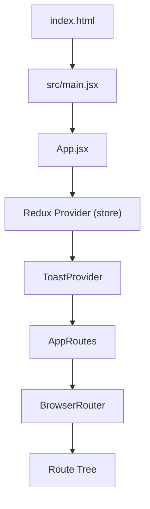
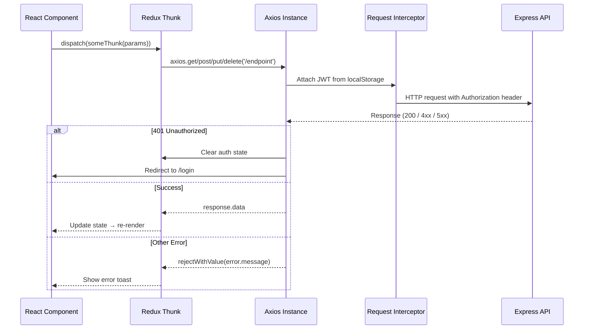

# Frontend Architecture

This document describes the frontend internals — how the React application is structured, how state is managed, how it communicates with the backend, and what each major page does. Read this after [Platform Overview](01-platform-overview.md) for product context and [Backend Architecture](03-backend-architecture.md) for the API contract.

---

## Technology Stack

| Technology | Purpose |
|-----------|---------|
| React 18 | UI framework |
| Vite | Build tool and dev server |
| React Router v6 | Client-side routing |
| Redux Toolkit (RTK) | Global state management with `createAsyncThunk` for async actions |
| Axios | HTTP client (configured instance with interceptors) |
| TailwindCSS | Utility-first CSS framework |
| Vercel / Netlify | Production static hosting |
| Nginx | Containerized/self-hosted deployments (via `frontend/nginx.conf`) |

---

## Application Entry Point



The entry chain is:

1. **`index.html`**: Static HTML shell with a `<div id="root">`.
2. **`src/main.jsx`**: Renders `<App />` into the root DOM node.
3. **`App.jsx`**: Wraps the application in three layers:
   - `<Provider store={store}>` — makes the Redux store available to all components.
   - `<ToastProvider />` — global toast notification system.
   - `<AppRoutes />` → `<BrowserRouter>` → `<Routes>` — the route tree.

---

## Routing and Role-Based Access

### `ProtectedRoute` Component

`App.jsx` implements a `ProtectedRoute` wrapper component that gates all authenticated routes:

1. Checks `state.auth.isAuthenticated` from the Redux store.
2. If **not authenticated** → redirects to `/login`.
3. If **authenticated but wrong role** (e.g., a campaign manager trying to access `/admin/*`) → redirects to the appropriate role-specific dashboard.

This is client-side enforcement only. The backend independently verifies JWT and role on every API request, so bypassing the frontend route guard does not grant unauthorized access.

### Full Route Table

| Path | Component | Required Role |
|------|-----------|--------------|
| `/login` | `Login.jsx` | Public |
| **Admin Routes** | | |
| `/admin/dashboard` | `pages/admin/Dashboard.jsx` | `admin` |
| `/admin/queue` | `pages/admin/QueueDashboard.jsx` | `admin` |
| `/admin/managers` | `pages/admin/Managers.jsx` | `admin` |
| `/admin/integrations` | `pages/admin/Integrations.jsx` | `admin` |
| `/admin/telephony` | `pages/admin/TelephonySettings.jsx` | `admin` |
| `/admin/campaigns` | `pages/admin/AllCampaigns.jsx` | `admin` |
| `/admin/logs` | `pages/admin/AllCallLogs.jsx` | `admin` |
| `/admin/logs/:callId` | `pages/admin/CallLogDetail.jsx` | `admin` |
| `/admin/reports` | `pages/admin/UsageReports.jsx` | `admin` |
| **Campaign Manager Routes** | | |
| `/cm/dashboard` | `pages/cm/Dashboard.jsx` | `campaign_manager` |
| `/cm/callers` | `pages/cm/Callers.jsx` | `campaign_manager` |
| `/cm/callers/:callerId/script` | `pages/cm/ScriptBuilder.jsx` | `campaign_manager` |
| `/cm/campaigns` | `pages/cm/Campaigns.jsx` | `campaign_manager` |
| `/cm/campaigns/:campaignId` | `pages/cm/CampaignDetail.jsx` | `campaign_manager` |
| `/cm/campaigns/:campaignId/sessions` | `pages/cm/CampaignSessions.jsx` | `campaign_manager` |
| `/cm/campaigns/:campaignId/sessions/:sid` | `pages/cm/SessionDetails.jsx` | `campaign_manager` |
| `/cm/leads` | Redirects to `/cm/campaigns` | `campaign_manager` |
| `/cm/logs` | `pages/cm/CallLogs.jsx` | `campaign_manager` |
| `/cm/logs/:callId` | `pages/cm/CallLogDetail.jsx` | `campaign_manager` |

---

## Redux Store Architecture

The global state is managed by Redux Toolkit. The store is composed in `store/index.js` from eight independent slices.

### Slice Inventory

| Slice | State Key | What It Manages |
|-------|-----------|----------------|
| `authSlice` | `auth` | JWT token, user object, authentication state, login/logout actions |
| `campaignsSlice` | `campaigns` | Campaign list, current campaign, campaign lifecycle actions (start/pause/stop) |
| `campaignSessionsSlice` | `campaignSessions` | Session list for a specific campaign, pagination, filters |
| `callersSlice` | `callers` | AI Caller list, current caller |
| `leadsSlice` | `leads` | Lead list for a campaign, CSV upload state |
| `callLogsSlice` | `callLogs` | Call log list with filtering |
| `knowledgeSlice` | `knowledge` | Knowledge base list |
| `usersSlice` | `users` | Manager list (admin-only) |

### Async Thunk Pattern

Every slice that communicates with the backend follows the same pattern:

```javascript
// 1. Define the thunk
export const fetchCampaigns = createAsyncThunk(
  'campaigns/fetchCampaigns',
  async (_, { rejectWithValue }) => {
    try {
      const response = await axios.get('/campaigns');
      return response.data;
    } catch (error) {
      return rejectWithValue(error.response?.data?.message || 'Failed to fetch campaigns');
    }
  }
);

// 2. Handle in extraReducers
builder
  .addCase(fetchCampaigns.pending, (state) => { state.loading = true; })
  .addCase(fetchCampaigns.fulfilled, (state, action) => {
    state.loading = false;
    state.campaigns = action.payload.data;
  })
  .addCase(fetchCampaigns.rejected, (state, action) => {
    state.loading = false;
    state.error = action.payload;
  });
```

All thunks use `rejectWithValue` to forward the backend's error message string. This is important because RTK's default rejection wraps errors in a way that loses the original message.

### Error Unwrapping Convention

A critical pattern used across all pages and components that consume thunk results:

```javascript
const resultAction = await dispatch(startCampaign(campaignId));
if (startCampaign.rejected.match(resultAction)) {
  const error = resultAction.payload;
  const msg = typeof error === 'string' ? error : error?.message || 'Operation failed';
  showToast(msg, 'error');
}
```

The `typeof error === 'string'` check is necessary because `rejectWithValue` can return either a raw string (when the backend returns a plain error message) or an object (when the error has structured fields). Every error display in the UI must handle both cases to avoid showing `[object Object]` or `undefined` to the user.

---

## API Communication

### Axios Instance (`utils/axios.js`)

A configured Axios instance is the sole HTTP client for all backend communication:

- **`baseURL`**: Read from the `VITE_API_URL` environment variable. This must point to the backend's public URL (e.g., `https://api.example.com` in production or `http://localhost:5000` in development).
- **Request interceptor**: On every outgoing request, reads the JWT token from `localStorage.getItem('token')` and attaches it as `Authorization: Bearer <token>`.
- **Response interceptor**: On a `401 Unauthorized` response, automatically clears the auth state in Redux, removes the token from localStorage, and redirects the user to `/login`. This ensures that expired or revoked tokens result in a clean logout rather than cryptic errors.

### Request Flow



---

## Authentication Flow

1. **Login**: User submits email and password on `Login.jsx`. The component dispatches `authSlice.login` thunk → `POST /api/auth/login`.
2. **Token storage**: The backend responds with `{ token, refreshToken, user }`. The thunk stores `token` and `refreshToken` in `localStorage` and the `user` object in Redux state.
3. **Subsequent requests**: The Axios request interceptor reads `token` from localStorage and attaches it to every outgoing request. No manual token management is needed in page components.
4. **Token expiry**: When any API request returns `401`, the response interceptor automatically dispatches a logout action (clears Redux auth state and localStorage) and redirects to `/login`.
5. **No silent refresh**: The token refresh endpoint exists in the backend (`POST /api/auth/refresh`) but is not actively called by the frontend on 401. The current behavior is a hard redirect to login.

---

## Major Pages

### Campaign Manager Pages

**`pages/cm/Campaigns.jsx`** (21KB) — The most complex campaign manager page.
The primary campaign management interface. Displays the list of campaigns with aggregated stats. Contains an embedded campaign create/edit form (`components/campaigns/CampaignForm.jsx`) and a lead CSV upload flow (modal with column mapping). Campaign lifecycle actions (Start, Pause) render conditionally based on the campaign's current status. The Stop action is only available from `CampaignDetail.jsx`.

**`pages/cm/CampaignDetail.jsx`** (12.5KB) — Single campaign view with live stats and lifecycle controls.
Displays one campaign with its current statistics. The control buttons follow strict rules:
- **Start**: Visible only when status is `draft` or `paused`.
- **Pause**: Visible only when status is `running`.
- **Stop**: Visible when status is `running` or `paused`. Requires `window.confirm()` because stopping is permanent.

The backend enforces these rules independently — sending a start request for a `stopped` campaign returns `400`.

**`pages/cm/CampaignSessions.jsx`** (13KB) — Paginated session list.
Displays all call sessions for a campaign with filters for status, call outcome, interest level, and free-text search. Each row links to `SessionDetails.jsx`.

**`pages/cm/SessionDetails.jsx`** (17.6KB) — Full call session view.
The richest data display page. Shows the complete transcript (turn-by-turn with speaker labels and timestamps), AI-extracted structured data (intent, interest level, callback, objections, notes), call summary, audio outcome, duration, model used, and cost estimates.

**`pages/cm/Callers.jsx`** (7.5KB) — AI Caller management.
Lists and creates `AICaller` records. Each caller row links to `ScriptBuilder.jsx` for the visual script flow editor.

**`pages/cm/Dashboard.jsx`** (25KB) — Campaign manager dashboard.
Summary statistics across all of the manager's campaigns and calls.

### Admin Pages

**`pages/admin/Integrations.jsx`** (42KB) — The largest file in the frontend.
Full integration lifecycle management for both `s2s` (Gemini API key) and `telephony` (Vobiz/Twilio credentials) integration types. Supports creating, testing (validates connectivity), activating, and deleting integrations.

**`pages/admin/TelephonySettings.jsx`** (31.5KB) — Legacy telephony configuration.
Writes to the `TelephonyConfig` model, which is not read by the active call pipeline. This page may appear functional but has no effect on actual calls. See [Known Gaps](12-known-gaps.md).

**`pages/admin/QueueDashboard.jsx`** (18.5KB) — Dial queue observability.
Real-time visibility into the `DialQueueJob` collection: job counts per status per campaign, timing percentiles, and dead-letter job management.

**`pages/admin/UsageReports.jsx`** — Usage reporting.
Aggregated usage data across managers showing call counts, durations, and outcomes. The backend queries use `.select('status durationSeconds').lean()` projections to avoid memory exhaustion.

**`pages/admin/Managers.jsx`** — Manager account management.
CRUD interface for campaign manager accounts. Set per-account call and minute limits.

---

## Component Library

```
components/
├── callers/                    — AI Caller-specific components
├── calls/                      — Call-related components
├── campaigns/
│   ├── CampaignForm.jsx        — Create/edit form (embedded in Campaigns.jsx)
│   ├── CampaignsList.jsx       — Table row renderer for campaign list
│   ├── CampaignControls.jsx    — DEAD CODE (see below)
│   └── CampaignStats.jsx       — Campaign statistics display
├── common/
│   ├── ToastProvider.jsx       — Global toast notification system
│   └── ...                     — Shared UI primitives
├── layout/
│   └── DashboardLayout.jsx     — Sidebar + header shell used by all authenticated pages
├── leads/
│   └── LeadUpload.jsx          — CSV upload UI with column-to-field mapping
├── script-builder/             — Visual script flow node components
└── users/                      — Manager management components
```

The `DashboardLayout.jsx` component provides the consistent sidebar navigation and header that wraps every authenticated page. It renders different navigation items based on the user's role.

---

## Frontend → Backend Action Map

| UI Action | Redux Thunk | HTTP Call | Backend Handler |
|-----------|------------|-----------|----------------|
| Login | `authSlice.login` | `POST /api/auth/login` | `authController.login` |
| Create Campaign | `campaignsSlice.createCampaign` | `POST /api/campaigns` | `campaignController.createCampaign` |
| Start Campaign | `campaignsSlice.startCampaign` | `POST /api/campaigns/:id/start` | `campaignController.startCampaign` |
| Pause Campaign | `campaignsSlice.pauseCampaign` | `POST /api/campaigns/:id/pause` | `campaignController.pauseCampaign` |
| Stop Campaign | `campaignsSlice.stopCampaign` | `POST /api/campaigns/:id/stop` | `campaignController.stopCampaign` |
| Upload Leads CSV | `leadsSlice.uploadLeads` | `POST /api/campaigns/:id/leads/upload` | `leadController.uploadLeads` |
| View Sessions | `campaignSessionsSlice.fetchSessions` | `GET /api/campaigns/:id/sessions` | `campaignController.getCampaignSessions` |
| Export Sessions | Direct download link | `GET /api/campaigns/:id/sessions/export` | `campaignController.getCampaignSessionsExport` |
| Create AI Caller | `callersSlice.createCaller` | `POST /api/callers` | `callerController.createCaller` |
| Create Integration | Inline Axios call in `Integrations.jsx` | `POST /api/integrations` | `integrationController.createIntegration` |
| Fetch Managers | `usersSlice.fetchUsers` | `GET /api/admin/managers` | `userController.getManagers` |

Note: The Integration management page uses inline Axios calls rather than a dedicated Redux slice. This is an inconsistency — most other features use Redux thunks.

---

## Dead Code: `CampaignControls.jsx`

`frontend/src/components/campaigns/CampaignControls.jsx` implements a modal with Start, Pause, and Stop campaign controls including confirmation dialogs. However, this component is **not imported or mounted by any currently-routed page**. Its functionality was migrated directly into `CampaignDetail.jsx`.

The file exists as dead code. It should be deleted or marked as deprecated. See [Known Gaps](12-known-gaps.md).
