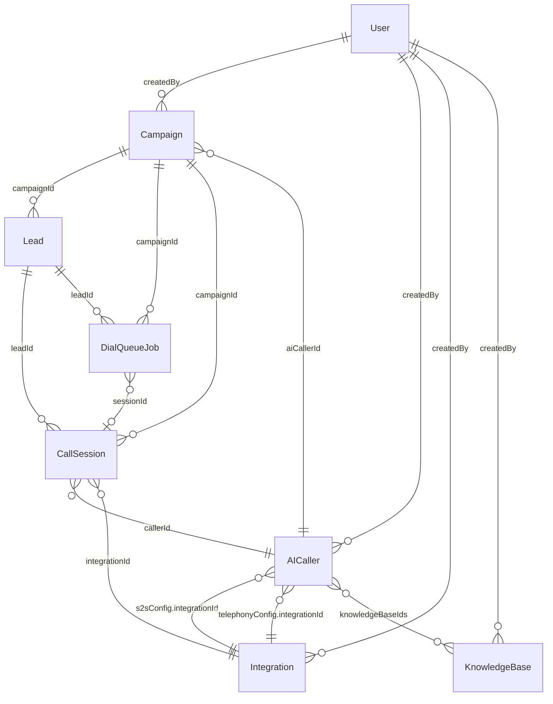
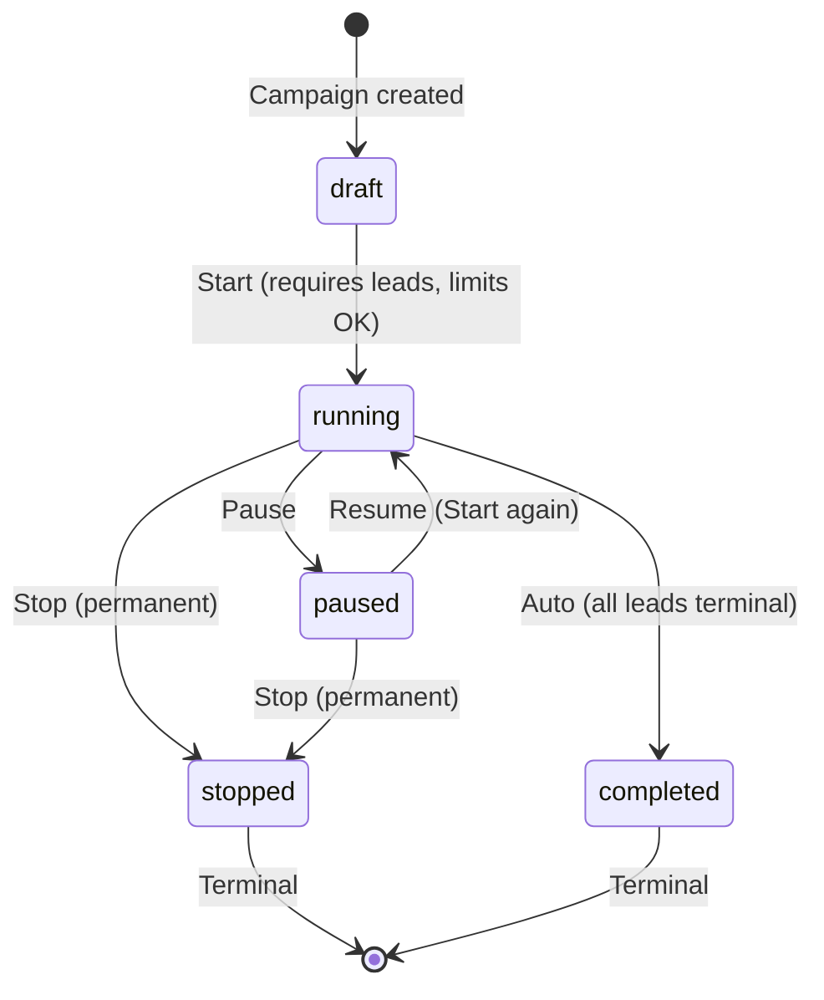
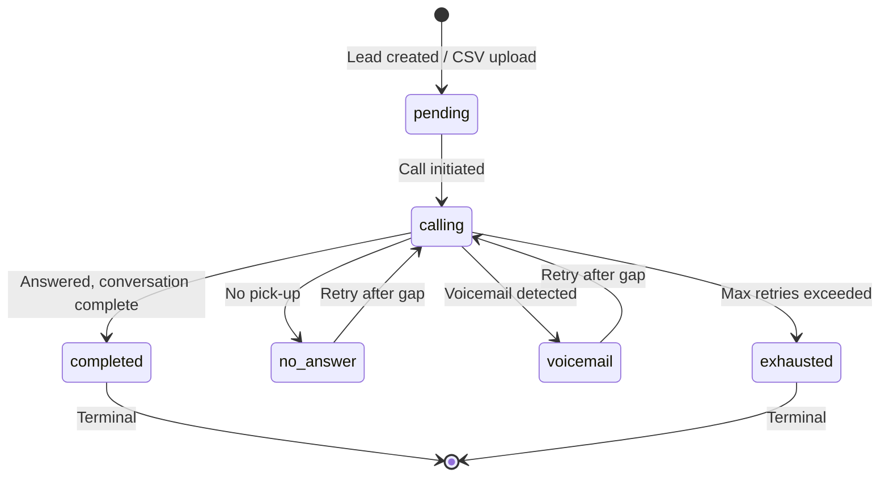
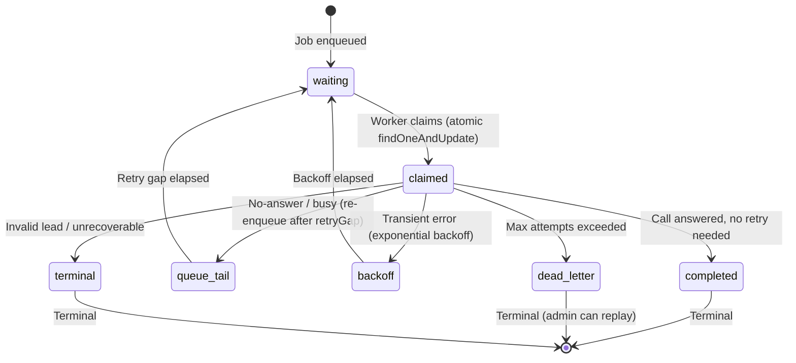

# Data Model

This document defines every database entity in the platform — its fields, relationships, indexes, methods, and state machines. This is the authoritative reference for understanding what data exists and how it changes through the system's lifecycle.

The platform uses MongoDB via Mongoose. All models are defined in `backend/src/models/`.

---

## Entity Relationship Overview

| Model | Collection | Key Relationships |
|-------|-----------|-------------------|
| `User` | `users` | Parent of all manager-owned data |
| `AICaller` | `aicallers` | Belongs to `User`; used by `Campaign` |
| `Campaign` | `campaigns` | Belongs to `User`; references `AICaller` |
| `Lead` | `leads` | Belongs to `Campaign` |
| `DialQueueJob` | `dialqueuejobs` | References `Campaign`, `Lead`, `CallSession` |
| `CallSession` | `callsessions` | References `Campaign`, `Lead`, `AICaller`, `User`, `Integration` |
| `Integration` | `integrations` | Belongs to `User`; referenced by `AICaller` and call initiation |
| `TelephonyConfig` | `telephonyconfigs` | Legacy singleton; superseded by `Integration` |
| `KnowledgeBase` | `knowledgebases` | Belongs to `User`; referenced by `AICaller.knowledgeBaseIds` |



---

## User

The `User` model represents both administrators and campaign managers. It is the root ownership entity — all campaigns, callers, and integrations trace back to a `User` via `createdBy`.

| Field | Type | Notes |
|-------|------|-------|
| `email` | String | Unique, required, stored lowercase |
| `password` | String | Bcrypt hashed. `select: false` — never included in queries unless explicitly requested |
| `name` | String | Display name |
| `role` | Enum | `admin` or `campaign_manager` |
| `limits.maxCalls` | Number | Maximum total calls allowed. `0` = unlimited |
| `limits.maxMinutes` | Number | Maximum total minutes allowed. `0` = unlimited |
| `usage.callsUsed` | Number | Incremented per call initiation |
| `usage.minutesUsed` | Number | Incremented per call based on `durationSeconds` |
| `createdBy` | ObjectId → User | Set when an admin creates a manager account |
| `isActive` | Boolean | Account active flag |
| `lastLogin` | Date | Updated on successful login |

### Key Method: `hasExceededLimits()`

Returns `false` for administrators (admins have no limits). For campaign managers:

- If `limits.maxCalls === 0`, calls are unlimited. Otherwise, returns `true` if `usage.callsUsed >= limits.maxCalls`.
- Same logic for `limits.maxMinutes`.

The `0 = unlimited` convention is critical. This was a previous source of bugs where `0` was treated as "zero capacity" instead of "no limit."

---

## AICaller

An AI Caller is the configured persona that Gemini Live uses during phone conversations. It defines what the AI says, how it sounds, and what safety limits apply.

| Field | Type | Notes |
|-------|------|-------|
| `name` | String | Display name for the caller |
| `createdBy` | ObjectId → User | Owner |
| `callingMechanism` | Enum | Currently only `s2s` (server-to-server) |
| `s2sConfig.provider` | String | Currently only `gemini_live` |
| `s2sConfig.integrationId` | ObjectId → Integration | Points to the Gemini API key integration |
| `s2sConfig.model` | String | Default: `gemini-3.8-live` |
| `s2sConfig.voice` | String | Default: `Kore` |
| `s2sConfig.systemPrompt` | String | Core instruction set injected into Gemini Live session |
| `s2sConfig.temperature` | Number | 0–2, default 0.8 |
| `s2sConfig.thinkingLevel` | Enum | `minimal`, `low`, `medium`, `high` |
| `telephonyConfig.integrationId` | ObjectId → Integration | Points to Vobiz/Twilio integration |
| `telephonyConfig.callerId` | String | Outbound phone number displayed to leads |
| `guardrails.maxCallDuration` | Number | Maximum call length in seconds |
| `guardrails.silenceTimeout` | Number | Seconds of silence before auto-hangup |
| `qaEntries` | Array | Q&A pairs (`{ question, answer }`) injected into Gemini context. Up to 20 entries, max 500 chars per Q, 1200 per A |
| `scriptFlow.nodes` | Array | Visual script graph nodes (types: `start`, `say`, `listen`, `condition`, `question`, `knowledge_lookup`, `tag`, `end_call`) |
| `scriptFlow.edges` | Array | Connections between script nodes |
| `knowledgeBaseIds` | ObjectId[] → KnowledgeBase | Linked knowledge documents |

**Script flow note**: The `scriptFlow` field stores a visual node graph built by the Script Builder UI. However, the bridge does **not** read or execute `scriptFlow` at call time. The system prompt approach is the sole runtime mechanism. See [Known Gaps](12-known-gaps.md).

---

## Campaign

A Campaign binds an AI Caller to a set of leads and defines the rules for how calls are placed.

| Field | Type | Notes |
|-------|------|-------|
| `name` | String | Campaign display name |
| `createdBy` | ObjectId → User | Owner |
| `aiCallerId` | ObjectId → AICaller | Required — the AI persona for this campaign |
| `settings.concurrencyLimit` | Number | 1–50, default 5. Max simultaneous calls |
| `settings.maxCallDuration` | Number | 30–600 seconds, default 180 |
| `settings.retryGap` | Number | Minutes between retries, min 15, default 120 |
| `settings.maxRetries` | Number | 1–10, default 3 |
| `settings.retryMode` | Enum | `queue_tail` or `backoff`, default `queue_tail` |
| `settings.callingWindow.startTime` | String | HH:mm format (e.g., `09:00`) |
| `settings.callingWindow.endTime` | String | HH:mm format (e.g., `18:00`) |
| `settings.callingWindow.timezone` | String | IANA timezone (e.g., `Asia/Kolkata`) |
| `settings.callingWindow.daysOfWeek` | Number[] | 0–6 (Sunday–Saturday) |
| `status` | Enum | `draft`, `running`, `paused`, `completed`, `stopped` |
| `stats.*` | Number | Aggregated call statistics |
| `customFields` | Array | `{ name, mappedFrom }` for CSV column mapping |
| `startedAt` | Date | Set when campaign starts |
| `completedAt` | Date | Set on stop or auto-complete |

### Campaign State Machine



Once a campaign reaches `stopped` or `completed`, it is **permanently terminal**. The backend rejects restart attempts with HTTP 400: `"Cannot start a campaign that is already stopped"`.

### Key Methods

- **`isWithinCallingWindow()`**: Checks if the current time falls within the configured calling window for the campaign's timezone and allowed days of the week. The dial queue worker calls this before claiming jobs.
- **`canAcceptCalls()`**: Combines status check (`running`) with calling window check.
- **`incrementStats(outcome, duration)`**: Updates the stored `stats` counters. Note: these stored stats may be overwritten at query time by `getCampaignsWithAggregatedStats()`, which runs a live MongoDB aggregation from `CallSession` documents.

---

## Lead

A Lead represents a person to be called within a campaign.

| Field | Type | Notes |
|-------|------|-------|
| `campaignId` | ObjectId → Campaign | Parent campaign |
| `name` | String | Lead's name |
| `phone` | String | Primary phone field (required) |
| `phoneNumber` | String | Secondary phone field (optional). `s2sCallingService` uses `lead.phoneNumber \|\| lead.phone` |
| `email` | String | Optional |
| `customFields` | Map\<String, String\> | Populated from CSV upload column mapping |
| `status` | Enum | `pending`, `queued`, `calling`, `connected`, `no_answer`, `voicemail`, `completed`, `exhausted` |
| `outcome` | String | Final call outcome (interested, not_interested, etc.) |
| `retryCount` | Number | Incremented each retry attempt |
| `nextRetryAt` | Date | When the lead becomes eligible for the next retry |
| `lastCalledAt` | Date | Timestamp of most recent call attempt |

**Dual phone field note**: Both `phone` and `phoneNumber` exist. The call initiation service prefers `phoneNumber` and falls back to `phone`. It is unclear whether this is intentional (different providers require different formats) or a historical artifact. See [Known Gaps](12-known-gaps.md).

### Lead State Machine



---

## DialQueueJob

A DialQueueJob represents a single call attempt for a single lead. It is the work unit that the dial queue worker claims and executes. For the complete queue architecture, see [Dial Queue System](07-dial-queue-system.md).

| Field | Type | Notes |
|-------|------|-------|
| `campaignId` | ObjectId → Campaign | Parent campaign |
| `leadId` | ObjectId → Lead | The lead to call |
| `sessionId` | ObjectId → CallSession | Set when the job begins execution |
| `status` | Enum | `waiting`, `claimed`, `completed`, `backoff`, `queue_tail`, `dead_letter`, `terminal` |
| `attemptCount` | Number | Incremented on each retry |
| `nextEligibleAt` | Date | Job not claimable until this time (used for retry delays) |
| `leaseOwner` | String | Worker ID (hostname + PID) that claimed this job |
| `leaseExpiresAt` | Date | Lease auto-expires at 5.5 minutes |
| `dedupeKey` | String | `campaign:{id}:lead:{id}:attempt:{n}` — unique sparse index for idempotency |
| `lastError` | Object | `{ failureCategory, errorCode, errorMessage, retryable, timestamp }` |
| `retryReason` | String | Human-readable retry reason |
| `retryStep` | Number | Affects exponential backoff multiplier |

### DialQueueJob State Machine



### Concurrency Control

`claimNextJob()` uses MongoDB `findOneAndUpdate` as an atomic compare-and-swap. The `leaseExpiresAt` field ensures that if the server crashes mid-call, the lease auto-expires in 5.5 minutes and the job becomes claimable again. The 5.5-minute lease is intentionally 30 seconds longer than the bridge's 5-minute hard stop — a legitimate call always completes before its lease expires.

---

## CallSession

The most data-rich document in the system. Created at call initiation, updated through the call lifecycle, and finalized post-call with transcript and extracted data.

| Field | Type | Notes |
|-------|------|-------|
| `campaignId` | ObjectId → Campaign | |
| `leadId` | ObjectId → Lead | |
| `callerId` | ObjectId → AICaller | The AI persona used |
| `createdBy` | ObjectId → User | Campaign owner |
| `integrationId` | ObjectId → Integration | The Gemini API integration used |
| `provider` | String | `vobiz` or `twilio` |
| `providerCallId` | String | Vobiz call UUID or Twilio CallSid |
| `twilioCallSid` | String | Legacy field, kept for backward compat |
| `status` | Enum | 13 values (see below) |
| `callOutcome` | Enum | 10 values (see below) |
| `attemptIndex` | Number | Which retry attempt this is (1-based) |
| `parentSessionId` | ObjectId → CallSession | Links retry chains |
| `transcriptTurns` | Array | `{ speaker, text, timestamp }` — turn-by-turn conversation |
| `transcriptText` | String | Full concatenated transcript |
| `extracted.intent` | String | AI-extracted: what the lead wanted |
| `extracted.interest_level` | String | AI-extracted: interested, not_interested, maybe, etc. |
| `extracted.callback` | Object | AI-extracted: callback time and notes |
| `extracted.objections` | Array | AI-extracted: objections raised by the lead |
| `extracted.notes` | String | AI-extracted: free-form notes |
| `extractor.ran` | Boolean | Whether extraction has been attempted |
| `extractor.model` | String | Model used for extraction |
| `extractor.success` | Boolean | Whether extraction succeeded |
| `extractor.error` | String | Error message if extraction failed |
| `extractor.ranAt` | Date | Timestamp of extraction attempt |
| `humanHandoff.callbackTime` | Date | Scheduled callback if lead requests one |
| `humanHandoff.notes` | String | Notes for human follow-up |
| `summary` | String | Bridge-generated call summary |
| `durationSeconds` | Number | Call duration |
| `bridgeMetrics` | Mixed | Timing data from the bridge |
| `tokenUsage` | Mixed | Gemini token usage breakdown |
| `estimatedTokenCostUsd` | Mixed | Estimated cost in USD |
| `estimatedTokenCostInr` | Mixed | Estimated cost in INR |

### Status Values

The 13 status values track the call from initiation to completion:

`initiated` → `ringing` → `in_progress` → `completed` / `failed` / `canceled` / `no_answer` / `busy` / `voicemail` / `system_error` / `timeout` / `exhausted` / `scheduled`

### Call Outcome Values

The 10 outcome values describe what happened on the call:

`answered`, `voicemail`, `no_answer`, `busy`, `failed`, `canceled`, `system_error`, `timeout`, `amd_machine`, `unknown`

---

## Integration

The `Integration` model stores credentials for external services (Gemini Live and Vobiz/Twilio). It is the unified configuration system that replaced the legacy `TelephonyConfig`.

| Field | Type | Notes |
|-------|------|-------|
| `name` | String | Human-readable name |
| `type` | Enum | `s2s` (Gemini) or `telephony` (Vobiz/Twilio) |
| `baseUrl` | String | API base URL |
| `authType` | Enum | `bearer_token`, `api_key_header`, `basic_auth`, `custom_header`, `none` |
| `authConfig.username` | String | For telephony: Vobiz authId or Twilio AccountSid |
| `authConfig.password` | String | For telephony: Vobiz authToken or Twilio AuthToken |
| `authConfig.token` | String | For s2s: Gemini API key |
| `metadata` | Map | Provider-specific data: `provider` (vobiz/twilio), `callerIds`, `apiBaseUrl` |
| `isDefault` | Boolean | Auto-selected if no explicit integrationId on the AI Caller |
| `isActive` | Boolean | Must be active to be used |
| `createdBy` | ObjectId → User | Owner |

### Pre-save Hook

The Integration model has a pre-save hook that enforces **one default per type**. When an integration is saved with `isDefault: true`, the hook sets `isDefault: false` on all other integrations of the same type. This prevents conflicting defaults.

### Resolution Priority

When `s2sCallingService` needs to find which integration to use:

**Gemini (s2s)**:
1. `AICaller.s2sConfig.integrationId` (explicit assignment)
2. `Integration.findOne({ type: 's2s', isActive: true, isDefault: true })`
3. `Integration.findOne({ type: 's2s', isActive: true })` with name containing "gemini"
4. Error: "No active Gemini S2S integration found"

**Telephony**:
1. `AICaller.telephonyConfig.integrationId` (explicit assignment)
2. `Integration.findOne({ type: 'telephony', isDefault: true, isActive: true })`
3. Error: "No active telephony integration found"

---

## TelephonyConfig (Legacy)

A legacy singleton model for server-wide telephony configuration. The active call pipeline (`s2sCallingService`) reads from `Integration` records, not from `TelephonyConfig`. The admin UI page (`/admin/telephony`) writes to this model, but those writes have no effect on actual calls.

This model exists for backward compatibility but is effectively dead. See [Known Gaps](12-known-gaps.md).

---

## KnowledgeBase

| Field | Type | Notes |
|-------|------|-------|
| `name` | String | Document name |
| `createdBy` | ObjectId → User | Owner |
| `status` | Enum | `processing`, `completed`, `failed` |
| `content` | String | Document content |

The backend CRUD routes exist and `AICaller.knowledgeBaseIds` can reference knowledge bases. However, there is **no frontend page** for campaign managers to manage knowledge bases. The feature is wired in the backend but not user-accessible. See [Known Gaps](12-known-gaps.md).

---

## Data Flow Through a Campaign

This section traces which documents are created and updated at each stage of a campaign's life. For the complete end-to-end execution flow with service interactions, see [Call Lifecycle](06-call-lifecycle.md).

```
1. User creates Campaign                    → Campaign (status: draft)
2. User uploads CSV                         → Lead × N (status: pending)
3. User clicks Start                        → Campaign (status: running)
4. AutodialerService enqueues leads          → DialQueueJob × N (status: waiting)
5. Worker claims a job                       → DialQueueJob (status: claimed, leaseExpiresAt set)
6. s2sCallingService initiates call          → CallSession (status: initiated)
                                             → Lead (status: calling)
7. Lead answers, call proceeds               → CallSession (status: in_progress)
8. Call ends                                 → CallSession (status: completed, transcript saved)
                                             → Lead (status: completed or no_answer)
                                             → DialQueueJob (status: completed or queue_tail)
9. Extraction runs                           → CallSession (extracted.* populated, extractor.ran: true)
                                             → Campaign (stats updated)
10. All leads terminal                       → Campaign (status: completed)
```
