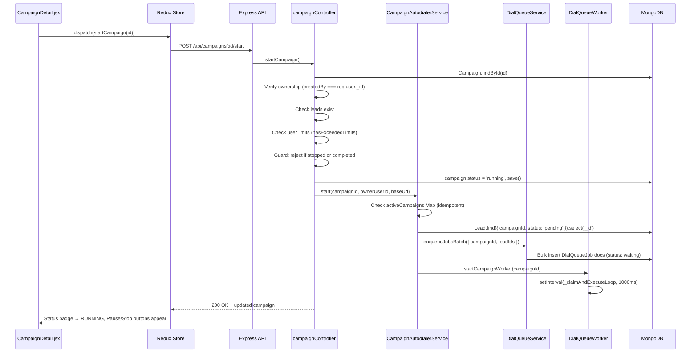
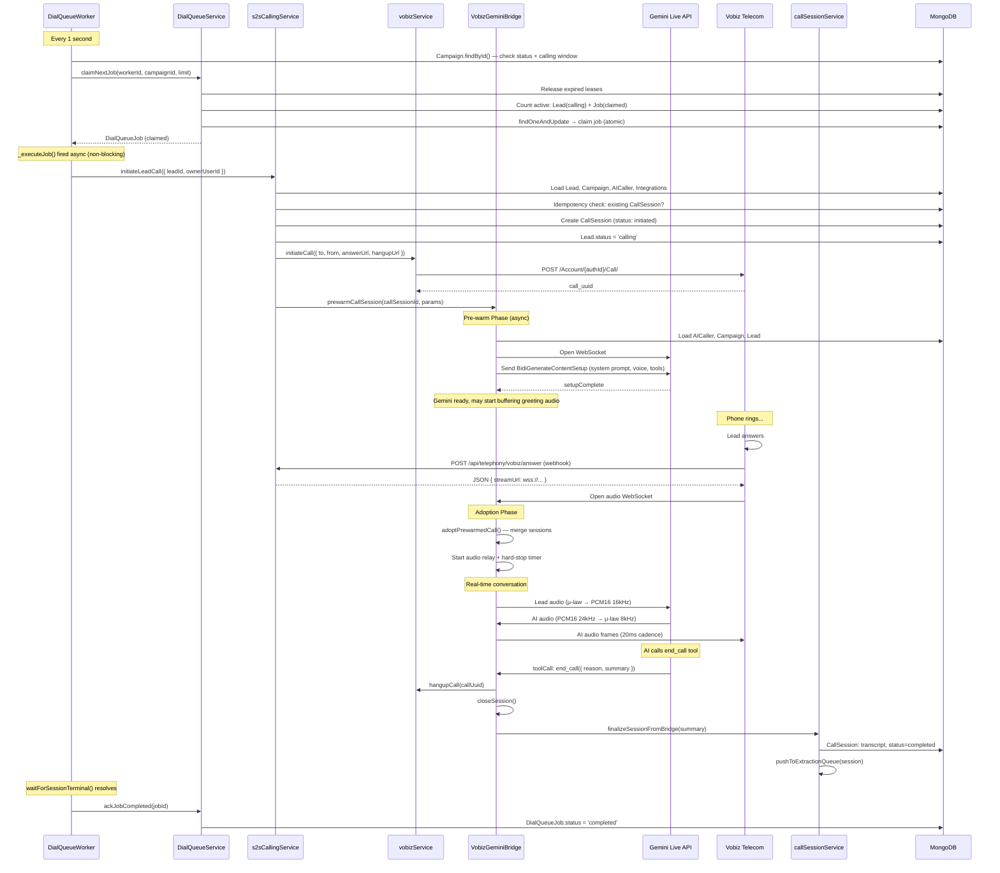
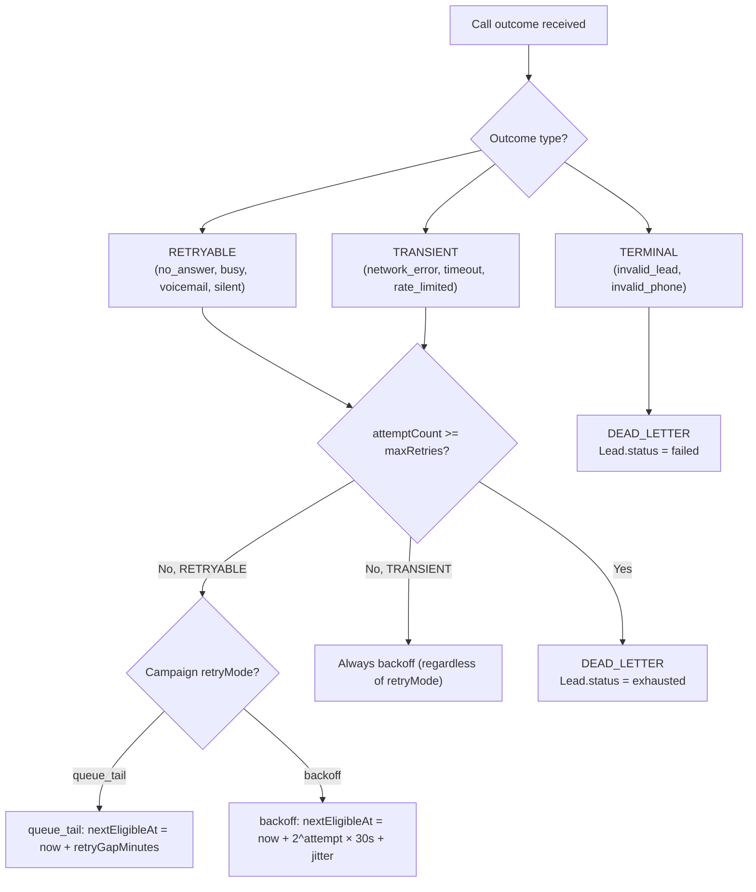

# Call Lifecycle

This is the most important workflow document in the project. It traces the complete execution flow from when a campaign manager clicks "Start Campaign" through queue processing, telephony, the AI conversation, and post-call data extraction. Every service, model, and runtime interaction is documented.

For the underlying data structures, see [Data Model](05-data-model.md). For deep dives into specific subsystems, see [Dial Queue System](07-dial-queue-system.md) and [Vobiz-Gemini Bridge](08-vobiz-gemini-bridge.md).

---

## Overview

When a campaign runs, the following happens automatically:

1. All pending leads are bulk-enqueued as `DialQueueJob` documents.
2. A 1-second worker loop claims jobs one at a time and initiates outbound calls.
3. For each call, the system simultaneously dials the lead's phone and pre-warms a Gemini Live WebSocket.
4. When the lead picks up, the pre-warmed Gemini connection is adopted and real-time audio relay begins.
5. The AI conducts the conversation, then calls `end_call` when finished.
6. The bridge saves the transcript and pushes the session to the extraction queue.
7. A separate Gemini API call extracts structured data from the transcript.
8. When all leads reach terminal states, the campaign auto-completes.

---

## Workflow 1: Campaign Launch

**Trigger**: Campaign manager clicks "Start Campaign" in `CampaignDetail.jsx`.



### Step-by-step

1. **Frontend**: `CampaignDetail.jsx` dispatches `campaignsSlice.startCampaign(campaignId)` → `POST /api/campaigns/:id/start` with JWT.
2. **Auth**: `protect` middleware validates JWT, `isAdminOrManager` checks role.
3. **Controller** (`campaignController.startCampaign`):
   - Fetches the `Campaign` by ID.
   - Verifies ownership: `campaign.createdBy === req.user._id`.
   - Checks leads exist via `campaignAutodialerService.hasAnyLeads()`.
   - Checks user limits via `req.user.hasExceededLimits()`.
   - **Guards** against `stopped` or `completed` status — returns 400 if terminal.
   - Sets `campaign.status = 'running'` and saves.
   - Calls `campaignAutodialerService.start(campaignId, ownerUserId, baseUrl)`.
4. **AutodialerService.start()**:
   - Checks if campaign is already in `activeCampaigns` Map (idempotent — prevents duplicate workers).
   - Adds campaign to Map with `{ ownerUserId, requestBaseUrl, inProgress: false, timer: null }`.
   - Calls `initializeQueueAndWorker()`.
5. **initializeQueueAndWorker()**:
   - Queries all `pending` leads: `Lead.find({ campaignId, status: 'pending' }).select('_id')`.
   - Calls `dialQueueService.enqueueJobsBatch({ campaignId, leadIds })` — bulk inserts `DialQueueJob` documents with `status: 'waiting'`. The enqueue is idempotent via the `dedupeKey` unique index.
   - Calls `dialQueueWorker.startCampaignWorker(campaignId, ownerUserId, requestBaseUrl)`.
6. **DialQueueWorker.startCampaignWorker()**:
   - Fetches the campaign's `concurrencyLimit`.
   - Starts `setInterval(_claimAndExecuteLoop, 1000)` — the worker loop that will claim and execute jobs.
7. **Response**: 200 OK with the updated campaign document.
8. **Redux**: Updates `campaigns[index]` and `currentCampaign` in store.
9. **UI**: Status badge changes to RUNNING. Start button disappears. Pause and Stop buttons appear.

---

## Workflow 2: Outbound Call Execution

**Trigger**: `_claimAndExecuteLoop` tick finds a claimable job.

This is the core of the platform — where all the components come together.



### Step-by-step

**1. Worker tick** (`_claimAndExecuteLoop`):
- Checks `campaignState.isProcessing` flag — if the previous tick is still running, this tick is skipped entirely.
- Fetches the campaign from DB: `Campaign.findById(campaignId).select('status settings')`.
- If `campaign.status !== 'running'` → skip. If `!campaign.isWithinCallingWindow()` → skip.
- Calls `dialQueueService.claimNextJob(workerId, campaignId, concurrencyLimit)`.

**2. Job claiming** (`claimNextJob` — atomic):
- First releases any expired leases: `DialQueueJob.updateMany({ status: 'claimed', leaseExpiresAt: { $lte: now } }, { $set: { status: 'waiting' } })`.
- Counts active concurrency: `Lead.countDocuments({ campaignId, status: 'calling' })` + `DialQueueJob.countDocuments({ campaignId, status: 'claimed' })`. If total >= concurrency limit → returns null.
- Atomically claims a job: `DialQueueJob.findOneAndUpdate({ status: { $in: ['waiting', 'queue_tail', 'backoff'] }, nextEligibleAt: { $lte: now } }, { $set: { status: 'claimed', leaseOwner: workerId, leaseExpiresAt: now + 5.5min } })`.

**3. Job execution** (`_executeJob` — fired async, non-blocking):
- Loads the Lead and checks `lead.isReadyForCall()`. If not ready (e.g., already `calling` or `completed`), calls `ackJobCompleted()` and returns.
- Calls `s2sCallingService.initiateLeadCall()`.

**4. Call initiation** (`s2sCallingService.initiateLeadCall`):
- Loads `Lead`, `Campaign`, `AICaller`, Gemini `Integration`, and telephony `Integration` from MongoDB.
- **Idempotency check**: Queries for an existing `CallSession` with the same `leadId`, `campaignId`, and `attemptIndex` in a non-failed status. If found, returns the existing session.
- Creates a `CallSession` document with `status: 'initiated'`.
- Sets `Lead.status = 'calling'`.
- Resolves the telephony provider from the Integration record (Vobiz or Twilio).
- **Vobiz path**: Calls `vobizService.initiateCall({ to, from, answerUrl, hangupUrl })` → POST to Vobiz API → returns `call_uuid`.
- **Pre-warm** (async, non-blocking): Calls `vobizGeminiBridge.prewarmCallSession({ callSessionId, params })`.

**5. Pre-warm** (`prewarmCallSession`):
- Creates a session object with `isPrewarmSession: true`.
- Registers it in `this.sessions` and `this.prewarmedCalls` Maps.
- Sets a 5-minute TTL timer.
- Loads `AICaller`, `Campaign`, `Lead` from MongoDB.
- Opens WebSocket to Gemini Live. Sends `BidiGenerateContentSetup` with the assembled system prompt, voice config, and tools.
- Waits for Gemini's `setupComplete` response. Once received, `session.geminiReady = true`.
- Gemini may start generating greeting audio, which is buffered (up to 5 seconds) in `outboundMulawQueue`.

**6. Lead answers** → Vobiz fires `POST /api/telephony/vobiz/answer` webhook:
- `telephonyController.vobizAnswerWebhook()` builds a WebSocket URL and returns JSON: `{ "action": "stream", "streamUrl": "wss://domain/api/telephony/vobiz/media-stream?callSessionId=..." }`.
- Vobiz opens a WebSocket to that URL.

**7. Prewarm adoption** (`adoptPrewarmedCall`):
- The bridge's upgrade handler creates a new live session.
- On the first `start` event from Vobiz: `adoptPrewarmedCall(liveSession)` merges the live session (with the Vobiz WebSocket) and the prewarm session (with the Gemini WebSocket).
- After adoption: the live session has both WebSockets, any buffered greeting audio, and `geminiReady: true`.
- If buffered audio exists → the lead hears the AI greeting immediately. If not → `requestProactiveGreeting()` tells Gemini to speak.
- Hard-stop timer (5 min) and silence watchdog (30s) are started.

**8. Real-time audio relay**:
- **Inbound** (lead → AI): Vobiz sends 20ms audio frames → μ-law decode → PCM16 at 8kHz → resample to 16kHz → send to Gemini Live.
- **Outbound** (AI → lead): Gemini sends PCM16 at 24kHz → downsample to 8kHz → μ-law encode → queue in 20ms frames → drain to Vobiz at real-time cadence.

**9. Call ends**:
- Gemini calls `end_call` tool → bridge sends tool response → waits 120ms → calls `vobizService.hangupCall()` → sends `{ event: 'stop' }` to Vobiz → `closeSession()`.
- OR: Hard stop timer fires after 5 minutes → forces `executeEndCall()`.
- OR: Silence watchdog triggers after 30 seconds of no activity → forces `executeEndCall()`.
- OR: Lead hangs up → Vobiz fires hangup webhook → bridge `closeSession()`.

**10. Session finalization** (`closeSession` → `finalizeSessionFromBridge`):
- Cancels all timers, closes all WebSockets.
- Computes cost estimates (Gemini tokens + Vobiz platform charge).
- Calls `callSessionService.finalizeSessionFromBridge(summary)`:
  - Updates `CallSession` with transcript, duration, outcome, metrics.
  - Sets `CallSession.status = 'completed'`.
  - Calls `pushToExtractionQueue(session)`.

**11. Worker completion**:
- `waitForSessionTerminal(callSessionId)` has been polling MongoDB for the session's status. It resolves when status is terminal.
- Worker inspects the outcome. If `answered` → `ackJobCompleted(jobId)`. If `no_answer`, `busy`, `voicemail`, etc. → triggers retry logic (see below).

---

## Workflow 3: Retry Logic

**Trigger**: Call fails with a retryable outcome.



### Error Categories

| Category | Codes | Retry Strategy |
|----------|-------|---------------|
| **RETRYABLE** | `NO_ANSWER`, `BUSY`, `VOICEMAIL`, `SILENT` | Queue tail or backoff, per campaign `retryMode` setting |
| **TRANSIENT** | `NETWORK_ERROR`, `TIMEOUT`, `SERVICE_UNAVAILABLE`, `RATE_LIMITED` | Always exponential backoff (regardless of campaign setting) |
| **TERMINAL** | `INVALID_LEAD`, `INVALID_PHONE`, `PERMISSION_DENIED`, `INVALID_PROVIDER` | Dead letter immediately — never retried |

### Queue Tail Mode

The job's `status` is set to `queue_tail` and `nextEligibleAt` is set to `now + retryGapMinutes` (default: 120 minutes). On the next worker tick after `nextEligibleAt` passes, the job becomes eligible for claiming again.

### Backoff Mode

The job's `status` is set to `backoff` and `nextEligibleAt` is set using an exponential formula: `2^attemptCount × 30,000ms + random jitter`. Each successive failure increases the delay geometrically.

### Dead Letter

When `attemptCount >= maxRetries` (default: 3), the job moves to `dead_letter` status. The lead's status is set to `exhausted`. Dead-letter jobs are visible in the admin Queue Dashboard and can be manually replayed via `POST /api/dial-queue/replay/:jobId`.

---

## Workflow 4: Lead CSV Upload

**Trigger**: Campaign manager uploads a CSV file in `Campaigns.jsx`.

1. **Frontend** (`LeadUpload.jsx`): User selects a CSV file. The component parses CSV headers and presents a column-to-field mapping UI. User maps CSV columns to lead fields (name, phone, email, custom fields). Submits as `POST /api/campaigns/:campaignId/leads/upload` (multipart/form-data, multer 50MB limit).
2. **Backend** (`leadController.uploadLeads`): Parses the CSV using the column mapping. Validates required fields (name, phone). Bulk inserts `Lead` documents with `status: 'pending'`. Updates `Campaign.stats.totalLeads`.
3. **Response**: Count of successfully imported leads.
4. **UI**: Lead count updates. The campaign is now ready to start.

---

## Workflow 5: Campaign Pause

1. User clicks "Pause Campaign" in `CampaignDetail.jsx`.
2. `POST /api/campaigns/:id/pause` → controller sets `campaign.status = 'paused'` and saves.
3. `campaignAutodialerService.pause(campaignId)`:
   - `clearTimeout(state.timer)` — stops the autodialer loop.
   - `dialQueueWorker.stopCampaignWorker(campaignId)` → `clearInterval(campaign.interval)` — stops the worker loop.
   - Removes from `activeCampaigns` Map.
4. **In-flight calls continue to completion.** The bridge handles them independently — pausing only prevents new calls from being initiated.
5. No new jobs are claimed. Existing `claimed` jobs finish normally.

---

## Workflow 6: Campaign Stop (Permanent)

1. User clicks "Stop Campaign" in `CampaignDetail.jsx` → `window.confirm()` required.
2. `POST /api/campaigns/:id/stop`.
3. Controller sets `campaign.status = 'stopped'`, `completedAt = new Date()`, saves.
4. `campaignAutodialerService.pause(campaignId)` — same as pause (stops workers).
5. The campaign is now permanently terminal. Attempting to restart returns 400: `"Cannot start a campaign that is already stopped"`.

---

## Workflow 7: Campaign Auto-Completion

**Trigger**: No claimable jobs remain and all leads are in terminal states.

Every time `claimNextJob()` returns null and at least 10 seconds have passed since the last check, `_checkCampaignCompletion()` runs:

```javascript
const activeLeadsCount = await Lead.countDocuments({
  campaignId,
  status: { $nin: ['completed', 'exhausted', 'failed', 'canceled'] }
});
if (activeLeadsCount === 0) {
  campaign.status = 'completed';
  campaign.completedAt = new Date();
  await campaign.save();
  await stopCampaignWorker(campaignId);
}
```

This is the only path to `completed` status without manual intervention.

---

## Workflow 8: Boot-Time Extraction Recovery

**Trigger**: Server/PM2 restart.

1. When `callSessionService.js` is first imported, it schedules `setTimeout(recoverMissedExtractions, 10000)`.
2. Ten seconds after boot, `recoverMissedExtractions()` runs:
   - Queries: `CallSession.find({ status: 'completed', 'extractor.ran': { $ne: true } }).limit(50).lean()`.
   - For each missed session: `pushToExtractionQueue(session)`.
3. `processExtractionQueue()` begins serial processing.

**Known limitation**: Only 50 sessions are recovered per boot. If there are more unprocessed sessions, they require additional restarts or manual intervention.

---

## Workflow 9: CDR Poll Fallback

**Trigger**: Every 60 seconds (or `VOBIZ_CDR_POLL_MS` from environment).

1. `vobizCdrPoller.pollOnce()`:
   - Fetches all active Vobiz telephony integrations.
   - For each: fetches CDR from `GET /Account/:authId/cdr/recent?limit=50`.
   - For each CDR entry: finds matching `CallSession` by `providerCallId`.
   - If the session is not yet terminal: calls `callSessionService.handleTwilioStatusUpdate()` to update the session.
2. This handles cases where Vobiz failed to deliver the hangup webhook, preventing sessions from getting stuck in `in_progress` indefinitely.

---

## Post-Call Extraction Pipeline

After every call, the extraction queue processes the session:

1. `pushToExtractionQueue(session)` adds the session to the in-memory queue.
2. `processExtractionQueue()` runs serially (one at a time):
   - Sends the full `transcriptText` to the Gemini extraction API (`GEMINI_EXTRACTION_MODEL`, default: `gemini-2.5-flash`).
   - The extraction prompt asks for structured data: intent, interest level, callback details, objections, and notes.
   - On success: updates `CallSession.extracted.*` fields and sets `extractor.ran = true`, `extractor.success = true`.
   - On failure: sets `extractor.ran = true`, `extractor.success = false`, `extractor.error = errorMessage`. The session data is preserved — only the extracted fields are missing.
3. Updates `Campaign.stats` and `Lead.status` based on the extraction results.

The extraction queue is serial to avoid overwhelming the Gemini API with concurrent requests. It processes sessions in the order they were pushed, with no parallelism.
