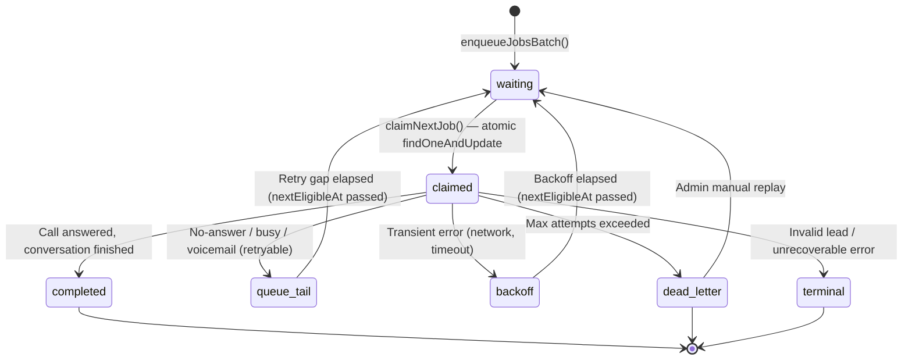
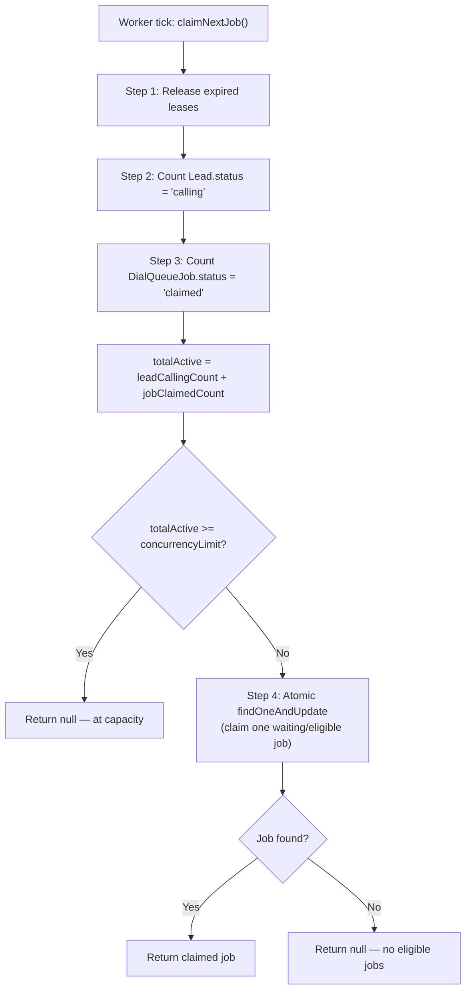
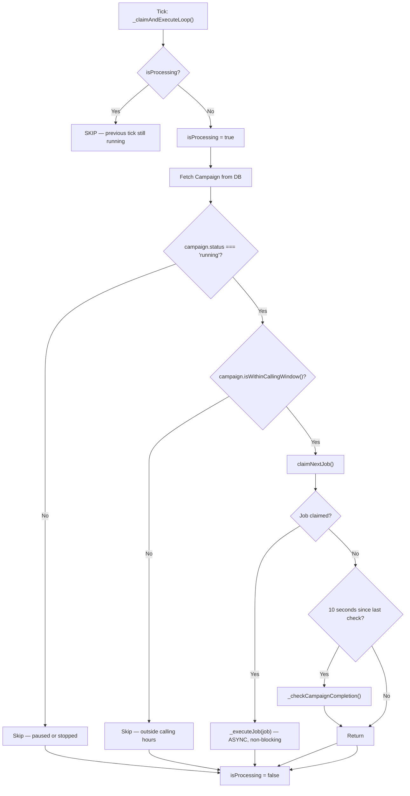

# Dial Queue System

This document is the deep architectural reference for the dial queue — the subsystem that controls when, how, and how many outbound calls are placed. It covers concurrency control, atomic job claiming, retry strategies, idempotency enforcement, and debugging guidance.

For the end-to-end call flow that the queue is part of, see [Call Lifecycle](06-call-lifecycle.md). For the data schema of `DialQueueJob`, see [Data Model](05-data-model.md).

---

## Why a Queue Exists

The platform needs to call thousands of leads across multiple campaigns simultaneously, subject to constraints that a simple loop cannot enforce:

- **Per-campaign concurrency limits** (e.g., max 5 simultaneous calls for campaign A, max 10 for campaign B).
- **Per-campaign retry rules** (retry gap in minutes, max retries, retry mode).
- **Calling windows** (only call between 9am–6pm in a specific timezone on specific days of the week).
- **Server restart durability** — progress must not be lost when PM2 restarts the process.
- **Idempotency** — a lead must never be called twice for the same attempt, even under race conditions.

The queue is implemented as MongoDB documents (`DialQueueJob` collection). Each lead-to-call pairing is a job document that transitions through states. The database itself is the durable queue — no Redis, no BullMQ, no external job system.

---

## Files Involved

| File | Responsibility |
|------|---------------|
| `models/DialQueueJob.js` | Mongoose schema, job state machine methods, state transition logic |
| `services/dialQueueService.js` | Stateless operations on DialQueueJob documents (enqueue, claim, ack, retry) |
| `services/dialQueueWorker.js` | In-process loop that claims and executes jobs per campaign |
| `services/campaignAutodialerService.js` | Orchestrator that populates the queue and starts/stops workers |

---

## DialQueueJob State Machine

A job document moves through these statuses over its lifetime:



### Status Definitions

| Status | Meaning | What Happens Next |
|--------|---------|------------------|
| `waiting` | Ready to be claimed. Initial state, or re-eligible after retry delay. | Next worker tick claims it (if under concurrency limit) |
| `claimed` | A worker has an active lease. Call is being attempted. | Call completes → one of the exit states |
| `completed` | Call resolved successfully (lead answered). Terminal. | Nothing — job is done |
| `queue_tail` | Retryable failure (no-answer, busy, voicemail). Waiting for retry gap. | Becomes `waiting` again after `nextEligibleAt` |
| `backoff` | Transient infrastructure error. Exponential backoff delay. | Becomes `waiting` again after `nextEligibleAt` |
| `dead_letter` | Max retries exceeded or manually dead-lettered. | Admin can replay via API; otherwise permanently done |
| `terminal` | Unrecoverable error (invalid phone, permission denied). | Never auto-retried |

---

## Concurrency Control

This is the most important and subtle part of the queue. Getting it wrong means either under-utilizing capacity (not enough concurrent calls) or over-running limits (more calls than the infrastructure can handle).

### The Problem

If a campaign has `concurrencyLimit: 5`, the system must never have more than 5 calls in flight simultaneously. But with a 1-second worker loop firing async call executions, there is a race window:

1. Worker claims a job → `DialQueueJob.status = 'claimed'`
2. `s2sCallingService.initiateLeadCall()` starts → `Lead.status = 'calling'` (happens slightly later)
3. Call runs for 2+ minutes
4. `ackJobCompleted()` marks job `completed` only after `waitForSessionTerminal()` resolves (after the call ends)

During this window, the job is `claimed` but the lead may or may not yet be `calling`. Counting only one would miss active calls.

### The Solution: Two-Level Count

`dialQueueService.claimNextJob()` counts both active indicators before claiming:



**Why count both `Lead.status='calling'` AND `DialQueueJob.status='claimed'`?**

Because they represent different phases of the same call:

- **`DialQueueJob.status = 'claimed'`**: The job has been claimed but `initiateLeadCall()` may not have run yet. The lead is not yet `calling`.
- **`Lead.status = 'calling'`**: The call has been initiated. The job will stay `claimed` until the entire call finishes and `ackJobCompleted()` runs.

Counting both prevents the system from over-counting during the transition window. The counts overlap briefly (both a `claimed` job and a `calling` lead exist for the same call), but this is conservative — it may briefly over-count by 1, which is safer than under-counting and launching too many calls.

### Atomic Job Claiming

`findOneAndUpdate` with a filter is MongoDB's compare-and-swap for this use case:

```javascript
const job = await DialQueueJob.findOneAndUpdate(
  {
    campaignId,
    status: { $in: ['waiting', 'queue_tail', 'backoff'] },
    nextEligibleAt: { $lte: now }
  },
  {
    $set: {
      status: 'claimed',
      leaseOwner: workerId,
      leaseExpiresAt: new Date(now.getTime() + LEASE_TIMEOUT_MS)
    }
  },
  { sort: { nextEligibleAt: 1, createdAt: 1 }, new: true }
);
```

Only one worker can claim any given job because MongoDB serializes writes at the document level. There is no separate distributed lock. The `sort` ensures FIFO ordering: oldest eligible jobs are claimed first.

### Lease Expiry

Every claimed job has `leaseExpiresAt = now + 5.5 minutes`. Before each `claimNextJob()` call, expired leases are released:

```javascript
await DialQueueJob.updateMany(
  { status: 'claimed', leaseExpiresAt: { $lte: now } },
  { $set: { status: 'waiting', leaseOwner: null, leaseExpiresAt: null } }
);
```

This means: if the server crashes or hangs mid-call, the job lease auto-expires in 5.5 minutes and the concurrency slot is freed. No manual database intervention is needed.

The 5.5-minute lease is intentionally 30 seconds longer than the bridge's 5-minute hard stop. A legitimate call always completes and is acknowledged before its lease expires. See [System Architecture — Timer Cascade](02-system-architecture.md#critical-design-decisions) for the full timer alignment.

### In-Process Semaphore

`dialQueueWorker.globalConcurrencySemaphore` is an in-memory counter that is incremented before `_performCall()` and decremented after. This is a **secondary check** — it does not replace the database-level concurrency control. Its purpose is to prevent the worker from even attempting a DB claim when it already knows it is at the global limit (`MAX_GLOBAL_CONCURRENCY`, default 50).

The semaphore resets to 0 on process restart, which is correct because no calls are active after a restart.

---

## Worker Loop

`startCampaignWorker(campaignId)` starts a `setInterval` running every 1 second:



### Key design decisions in the worker loop

**Non-blocking job execution**: `_executeJob()` is fired **without `await`**. This is intentional — the interval loop must not block waiting for a 2-minute phone call to finish. Each claimed job runs its call independently as a detached async operation, while the worker loop continues ticking every second and claiming new jobs up to the concurrency limit.

**`isProcessing` guard**: The `campaignState.isProcessing` flag prevents overlapping ticks. If a previous tick's database query is slow (e.g., MongoDB latency spike), the next tick sees `isProcessing = true` and exits immediately. This prevents the worker from issuing multiple concurrent `claimNextJob()` calls, which could result in claiming more jobs than intended in a single tick.

**Campaign status re-check**: Every tick re-fetches the campaign from MongoDB to check if it is still `running` and within the calling window. This ensures that a pause or stop action takes effect within 1 second.

---

## Job Execution

### `_executeJob(job, ownerUserId, requestBaseUrl)`

```
1. Load Lead, check lead.isReadyForCall()
   → If not ready (already 'calling' or 'completed'): ackJobCompleted() and return
   → Prevents double-calling a lead

2. globalConcurrencySemaphore++

3. executePromise = _performCall(job, ...)
   → s2sCallingService.initiateLeadCall()
   → callSessionService.waitForSessionTerminal(callSessionId)  ← BLOCKS HERE

4. await Promise.race([executePromise, setTimeout(leaseTimeout)])
   → If call completes first: check outcome
   → If lease timeout fires first: throw error → retry handling

5. On success (lead answered): ackJobCompleted(jobId)
6. On any error: _categorizeError(error) → ackJobWithRetry(...)

7. Finally: globalConcurrencySemaphore--
```

### What "Success" and "Failure" Mean

After `s2sCallingService.initiateLeadCall()` returns, the worker blocks on `callSessionService.waitForSessionTerminal(callSessionId)`, which polls MongoDB until the `CallSession` reaches a terminal status.

Then it inspects the call outcome:

```javascript
if (['no_answer', 'busy', 'failed', 'canceled', 'voicemail', 'system_error'].includes(outcome)) {
  const err = new Error(`Call did not connect (Outcome: ${outcome})`);
  err.code = outcome.toUpperCase();
  throw err;  // → triggers ackJobWithRetry()
}
// Otherwise: call answered → return result → ackJobCompleted()
```

A **successful** job (`ackJobCompleted()`) means the lead actually picked up the phone and had a conversation. A no-answer, busy signal, or voicemail is a **failure** that enters the retry pipeline — even though the telephony provider technically "completed" the call.

---

## Retry Handling

### `ackJobWithRetry(jobId, retryMode, failureCategory, errorCode, errorMessage, maxRetries, retryGapMinutes)`

```
1. Load the job from DB
2. if job.attemptCount > maxRetries → markDeadLetter(), Lead.status = 'exhausted'

3. If failureCategory === TERMINAL:
   → markDeadLetter(), Lead.status = 'failed'

4. If failureCategory === RETRYABLE:
   if retryMode === QUEUE_TAIL:
     → job.markQueueTailRetry(errorCode, retryGapMinutes)
       → status = 'queue_tail'
       → nextEligibleAt = now + retryGapMinutes (default 120 min)
       → attemptCount++
   else (BACKOFF):
     → job.getExponentialBackoffMs() → 2^attemptCount × 30000ms + jitter
     → job.markBackoffRetry(errorCode, errorMessage, backoffMs)
       → status = 'backoff'
       → nextEligibleAt = now + backoffMs

5. If failureCategory === TRANSIENT:
   → Always backoff (regardless of retryMode setting)

6. Sync Lead.status and Lead.nextRetryAt
```

### Error Categories

| Category | When Assigned | Codes | Retry Strategy |
|----------|-------------|-------|---------------|
| **RETRYABLE** | Normal call failures | `NO_ANSWER`, `BUSY`, `VOICEMAIL`, `SILENT` | Queue tail or backoff, per campaign `settings.retryMode` |
| **TRANSIENT** | Infrastructure failures | `NETWORK_ERROR`, `TIMEOUT`, `SERVICE_UNAVAILABLE`, `RATE_LIMITED` | Always exponential backoff (overrides campaign setting) |
| **TERMINAL** | Unrecoverable errors | `INVALID_LEAD`, `INVALID_PHONE`, `PERMISSION_DENIED`, `INVALID_PROVIDER` | Dead letter immediately — never retried |
| **RETRYABLE** (default) | Anything uncategorized | Any other error code | Safer default — retries rather than permanently failing |

### Exponential Backoff Formula

```
delay = 2^attemptCount × 30,000ms + random(0, 5000)ms
```

| Attempt | Base Delay | With Max Jitter |
|---------|-----------|----------------|
| 1 | 60 seconds | ~65 seconds |
| 2 | 120 seconds | ~125 seconds |
| 3 | 240 seconds | ~245 seconds |
| 4 | 480 seconds | ~485 seconds |

The jitter prevents thundering herd problems if many jobs fail simultaneously.

---

## Idempotency

Idempotency is enforced at **four independent layers**, each catching a different class of race condition:

### Layer 1: DialQueueJob Deduplication (`dedupeKey`)

The `dedupeKey` field has a unique sparse index: `campaign:{campaignId}:lead:{leadId}:attempt:{n}`.

When `enqueueJobsBatch()` runs, it first fetches all existing jobs for those leads. For existing ones, it does `updateOne` (resets to `waiting`). For new ones, it does `insertOne`. Re-running enqueue for the same leads is safe — no duplicate job documents are created.

### Layer 2: CallSession Idempotency Check

Inside `s2sCallingService.initiateLeadCall()`:

```javascript
const existingSession = await CallSession.findOne({
  leadId: lead._id,
  campaignId: campaign._id,
  attemptIndex: attemptNumber,
  status: { $nin: ['failed', 'canceled', 'scheduled'] },
});
if (existingSession) {
  return { ...existingSession, cached: true };  // Don't initiate another call
}
```

This prevents the same lead attempt from producing two simultaneous outbound calls, even if the worker fires twice for the same job due to a race condition.

### Layer 3: Worker Tick Guard (`isProcessing`)

`campaignState.isProcessing = true` while a tick is executing. The next tick checks this flag and exits immediately if set. This prevents the worker from claiming multiple jobs in the same tick if a database query is slow, which could result in exceeding the concurrency limit.

### Layer 4: Bridge Tool Call Deduplication

Inside the bridge, `session.processedToolCallIds` is a `Set`. If Gemini sends the same `end_call` tool call twice (identified by tool call ID or by `{name}:{args}` hash), the second invocation is silently dropped. This prevents duplicate hangup attempts during the call.

---

## Campaign Completion Detection

Every time `claimNextJob()` returns null (no claimable jobs) and at least 10 seconds have passed since the last check, `_checkCampaignCompletion()` runs:

```javascript
const activeLeadsCount = await Lead.countDocuments({
  campaignId,
  status: { $nin: ['completed', 'exhausted', 'failed', 'canceled'] }
});
if (activeLeadsCount === 0) {
  campaign.status = 'completed';
  campaign.completedAt = new Date();
  await campaign.save();
  await stopCampaignWorker(campaignId);
}
```

When all leads are in terminal states and no jobs are claimable, the campaign auto-completes. This is the only path to `completed` status without manual intervention.

---

## Worker Lifecycle

### Start

```
CampaignAutodialerService.start(campaignId)
  → initializeQueueAndWorker()
    → dialQueueService.enqueueJobsBatch(all pending leads)
    → dialQueueWorker.startCampaignWorker(campaignId)
      → setInterval(_claimAndExecuteLoop, 1000)
      → activeCampaigns.set(campaignId, { interval, stats })
```

### Pause

```
CampaignAutodialerService.pause(campaignId)
  → dialQueueWorker.stopCampaignWorker(campaignId)
    → clearInterval(campaign.interval)
    → activeCampaigns.delete(campaignId)
```

In-flight calls continue to completion independently. Pausing only stops the worker from claiming new jobs.

### Resume (Re-start After Pause)

Identical to Start. When the campaign is in `paused` status and the user clicks Start again:

1. Controller updates `campaign.status = 'running'`.
2. Calls `campaignAutodialerService.start()` again.
3. This re-runs `enqueueJobsBatch()` — which is idempotent via the `dedupeKey` index. Existing jobs are reset to `waiting`; no duplicates are created.
4. Starts a fresh worker interval.

### After Server Restart

Workers are **not persisted**. The `activeCampaigns` Maps in both `CampaignAutodialerService` and `DialQueueWorker` are empty after a PM2 restart.

Campaigns with `status: 'running'` in MongoDB have no active workers. Outbound calling is halted until an operator manually clicks Start on each campaign. There is no automatic worker recovery on boot. See [Known Gaps](12-known-gaps.md).

---

## Dead-Letter Management

Jobs in `dead_letter` status are never automatically retried. They appear in the admin Queue Dashboard and can be managed:

- **View**: `GET /api/dial-queue/dead-letter` — lists all dead-letter jobs with error details.
- **Replay**: `POST /api/dial-queue/replay/:jobId` — resets `status = 'waiting'`, `attemptCount = 1`. The job becomes eligible on the next worker tick.

Dead-letter replay is an admin-only action. It is the safety net for leads that exhausted their retries or hit unrecoverable errors but need another attempt (e.g., after fixing a configuration issue).

---

## Key Numbers Reference

| Parameter | Default | Source | Notes |
|-----------|---------|--------|-------|
| Worker tick interval | 1,000ms | `DIAL_QUEUE_CLAIM_INTERVAL_MS` constant | How often the worker checks for claimable jobs |
| Job lease duration | 5.5 minutes | `DIAL_QUEUE_LEASE_TIMEOUT_MS` constant | Auto-expires if worker crashes mid-call |
| Bridge hard stop | 5 minutes | `HARD_STOP_TIMEOUT_MS` constant | Forces call end — always completes before lease expires |
| Max global concurrency | 50 | `MAX_GLOBAL_CONCURRENCY` env var | Ceiling across all campaigns |
| Default campaign concurrency | 5 | `campaign.settings.concurrencyLimit` | Per-campaign limit (1–50) |
| Default retry gap | 120 minutes | `campaign.settings.retryGap` | Time before retrying a no-answer lead |
| Default max retries | 3 | `campaign.settings.maxRetries` | Attempts before dead-lettering |
| Completion check throttle | 10 seconds | Hardcoded in `_claimAndExecuteLoop` | Prevents checking completion on every empty tick |
| Batch enqueue size | 2,500 ops/batch | `dialQueueService.enqueueJobsBatch` | MongoDB bulk operation batch limit |

---

## Debugging Playbook

### "Calls aren't being made"

1. **Check campaign status in DB**: `Campaign.findById(id)` — must be `running`. If it is `running` but was never restarted after a PM2 restart, the worker is not active.
2. **Check calling window**: `campaign.isWithinCallingWindow()` — may be outside configured calling hours for the campaign's timezone.
3. **Check eligible jobs**: `DialQueueJob.countDocuments({ campaignId, status: 'waiting' })` — if 0, all jobs are either completed, dead-lettered, or waiting for retry delays.
4. **Check worker status**: Look in PM2 logs for `startCampaignWorker` messages. If absent since the last restart, the worker is not running. An operator must click Start.
5. **Check concurrency saturation**: Count `Lead.countDocuments({ campaignId, status: 'calling' })` + `DialQueueJob.countDocuments({ campaignId, status: 'claimed' })`. If this equals the concurrency limit, all slots are occupied.

### "Calls are stuck / not completing"

1. **Check for leaked leases**: `DialQueueJob.find({ status: 'claimed', leaseExpiresAt: { $lte: new Date() } })`. These are jobs where the worker crashed after claiming but before completing. They will auto-release on the next `_releaseExpiredLeases()` call (runs every tick), or you can run `fix_global_stuck.js`.
2. **Check stuck CallSessions**: `CallSession.find({ status: { $in: ['initiated', 'in_progress'] }, updatedAt: { $lt: fiveMinutesAgo } })`. These are sessions where the bridge crashed without finalizing. The CDR poller should recover them within 60 seconds, but if it doesn't, manual status update may be needed.
3. **Check if the bridge is healthy**: Look for WebSocket error messages in PM2 logs. If Gemini Live WebSockets are failing to connect, pre-warm will fail silently and calls may not proceed.

### "Same lead called twice"

1. **Check CallSession duplicates**: `CallSession.find({ leadId, campaignId, attemptIndex })`. If two documents exist with the same `attemptIndex` in non-failed statuses, the idempotency check in `s2sCallingService` was bypassed (likely a timing race).
2. **Check DialQueueJob duplicates**: `DialQueueJob.find({ leadId, campaignId })`. The `dedupeKey` unique index should prevent this, but check for multiple documents with similar keys.

### "Campaign won't complete"

1. **Check for non-terminal leads**: `Lead.countDocuments({ campaignId, status: { $nin: ['completed', 'exhausted', 'failed', 'canceled'] } })`. If this is not 0, some leads are stuck.
2. **Check for stuck `calling` leads**: `Lead.find({ campaignId, status: 'calling', lastCalledAt: { $lt: fiveMinutesAgo } })`. These are leads where the bridge crashed without updating the lead status. Manually set them to `no_answer` or `exhausted` to unblock the campaign.
