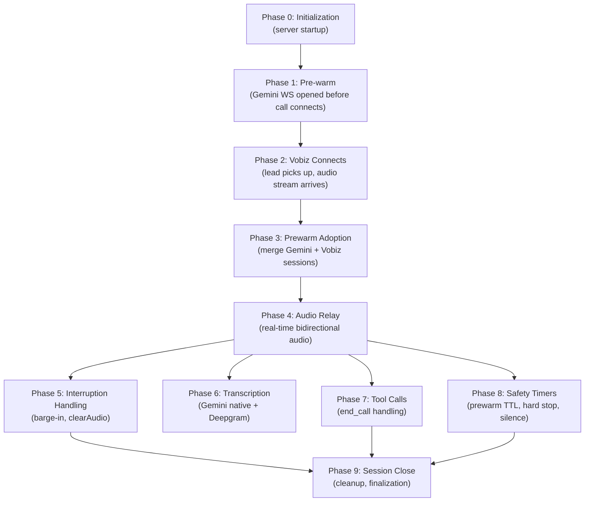
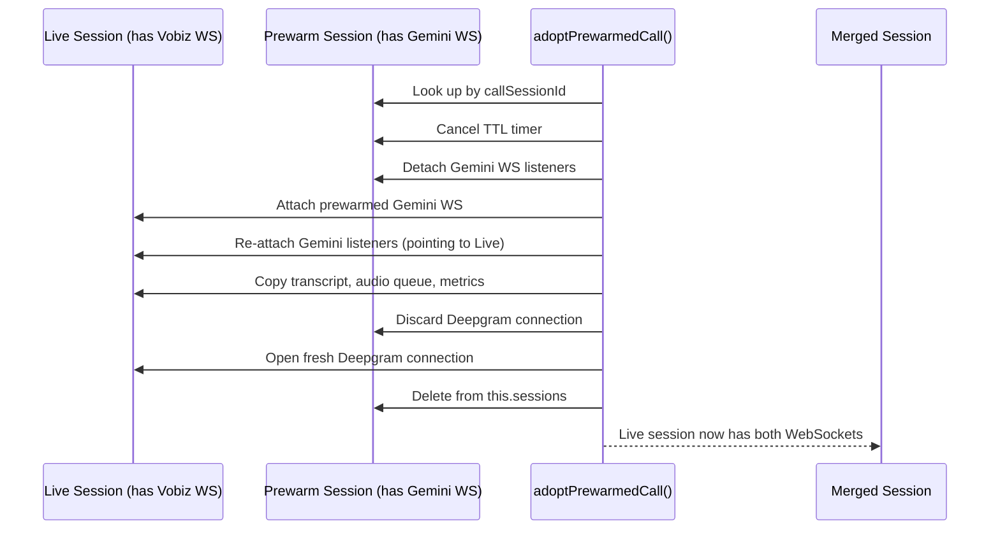
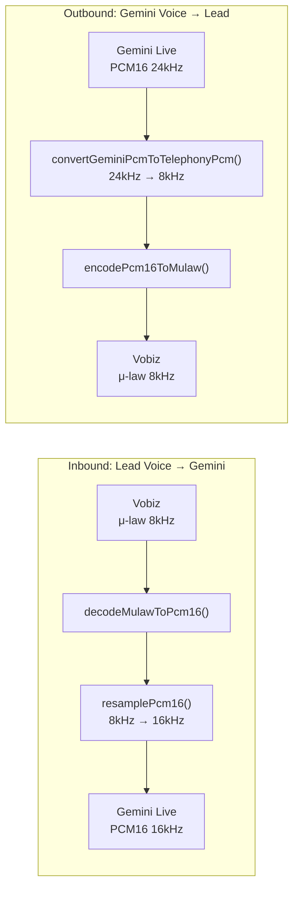

# Vobiz-Gemini Bridge

This document is the deep technical reference for `vobizGeminiBridge.js` — the real-time AI telephony engine that owns every active phone call. At 2,401 lines and 89KB, it is the single largest and most complex file in the codebase.

For context on how the bridge fits into the overall call flow, see [Call Lifecycle](06-call-lifecycle.md). For the queue system that triggers calls, see [Dial Queue System](07-dial-queue-system.md).

---

## What This File Does

The bridge is responsible for the entire runtime life of every active phone call:

- Accepts the audio stream from Vobiz when a lead picks up the phone
- Opens and manages a WebSocket to Google Gemini Live
- Transcodes audio bidirectionally in real-time (μ-law ↔ PCM16, 8kHz ↔ 16kHz ↔ 24kHz)
- Handles AI tool calls (including `end_call` to terminate the conversation)
- Enforces safety timers (pre-warm TTL, hard stop, silence watchdog)
- Collects the full transcript during the call (dual-source: Gemini native + Deepgram)
- Handles barge-in interruptions (lead talks over the AI)
- Triggers the post-call extraction pipeline
- Tracks token usage and estimates cost per call

The bridge is a **singleton** — exported as `new VobizGeminiBridge()`. One instance exists for the lifetime of the process, managing all concurrent calls via in-memory Maps.

---

## Lifecycle Overview



---

## Top-Level Data Structures

### `this.sessions` (Map)

Keyed by a random UUID (`sessionId`). Contains **every currently active session**, including pre-warm sessions that have not yet received a Vobiz audio stream. A session object is the central state container for one call — it holds both WebSocket references, the transcript, audio queues, timers, and metrics.

### `this.prewarmedCalls` (Map)

Keyed by `callSessionId` (the MongoDB `CallSession` ObjectId). Contains pre-warm session objects that have connected to Gemini but are waiting for Vobiz's audio stream to arrive. When a Vobiz WebSocket connects and matches a pre-warmed `callSessionId`, the pre-warm is adopted and removed from this Map.

### `this.config` (Object)

Runtime configuration read from environment variables at construction:

| Config Key | Default | Purpose |
|-----------|---------|---------|
| `prewarmEnabled` | `true` | Whether to pre-warm Gemini connections |
| `prewarmTtlMs` | 300,000 (5 min) | How long to hold a pre-warm slot open |
| `prewarmMaxBufferMs` | 5,000 (5 sec) | Max audio to buffer during pre-warm before dropping |
| `tokenPricingUsdPer1M` | Varies by modality | Gemini token cost rates for estimation |
| `vobizInrPerMinute` | 0.65 | Vobiz platform charge per minute |

### Session Object (Per Call)

Each session is a plain JavaScript object with approximately 40 fields:

| Field | Type | Purpose |
|-------|------|---------|
| `id` | string | UUID for this session |
| `vobizWs` | WebSocket | Connection from Vobiz to this server |
| `geminiWs` | WebSocket | Connection from this server to Gemini Live |
| `transcript` | Array | Turn-by-turn conversation log |
| `outboundMulawQueue` | Buffer[] | Queue of 20ms audio frames waiting to send to Vobiz |
| `outboundMulawRemainder` | Buffer | Partial frame accumulator for Gemini→Vobiz conversion |
| `pendingAudioChunks` | string[] | Lead audio received before Gemini was ready |
| `geminiReady` | boolean | `true` after Gemini sends `setupComplete` |
| `modelIsSpeaking` | boolean | `true` while AI audio is actively playing |
| `endingCallInProgress` | boolean | Guard against duplicate end-call executions |
| `maxCallDurationHardStopTimer` | Timer | 5-minute absolute kill switch |
| `noResponseTimer` | Timer | 30-second silence watchdog |
| `vobizPlaybackTimer` | Timer | 20ms interval for draining `outboundMulawQueue` |
| `sttWs` | WebSocket | Deepgram connection for Hinglish transcript |
| `sttReady` | boolean | `true` when Deepgram is connected |
| `metrics` | Object | 30+ counters for performance and cost tracking |
| `processedToolCallIds` | Set | Prevents duplicate tool call execution |
| `isPrewarmSession` | boolean | `true` if no Vobiz audio stream yet attached |
| `closed` | boolean | Idempotency guard for `closeSession()` |

---

## Phase 0: Initialization

Called once at server startup in `server.js`:

```
vobizGeminiBridge.initialize(server)
```

The bridge registers a WebSocket upgrade interceptor on the shared HTTP server:

```
server.on('upgrade', (request, socket, head) => {
  if (request.url matches '/api/telephony/vobiz/media-stream'):
    → wss.handleUpgrade(request, socket, head)
    → emit('connection', ws, request)
    → handleVobizConnection(ws, request)
});
```

The bridge does **not** bind to its own port. It hijacks the HTTP server's `upgrade` event and routes by URL path. This means Vobiz audio streams and the Express REST API share a single port (5000).

---

## Phase 1: Pre-warm (`prewarmCallSession()`)

Called by `s2sCallingService.initiateLeadCall()` immediately after the Vobiz API call is placed — **before Vobiz has even dialed the lead's phone**:

```
s2sCallingService.initiateLeadCall()
  └── vobizService.initiateCall()           ← tells Vobiz to dial
  └── vobizGeminiBridge.prewarmCallSession() ← fires async, non-blocking
```

### What pre-warm does:

1. Creates a full session object with `isPrewarmSession: true`.
2. Registers it in both `this.sessions` (by UUID) and `this.prewarmedCalls` (by `callSessionId`).
3. Sets a **5-minute TTL timer** — if no Vobiz audio stream arrives within 5 minutes, the session is auto-closed via `closeSession('prewarm-timeout')`.
4. Loads `AICaller`, `Campaign`, and `Lead` from MongoDB so they are ready at call connect time.
5. Calls `connectGeminiSession(prewarmSession)`:
   - Opens a WebSocket to Gemini Live API.
   - On `open`: assembles the full system prompt and sends `BidiGenerateContentSetup`.
   - Waits for Gemini's `setupComplete` response.
6. Once `setupComplete` arrives, `session.geminiReady = true`.
7. Gemini may start generating greeting audio immediately — this audio is buffered in `outboundMulawQueue`, capped at `prewarmMaxBufferMs` (5 seconds) to prevent unbounded memory growth.

**Why pre-warm exists**: By the time the lead picks up (typically 5–15 seconds after dialing), Gemini is already connected, the AI context is loaded, and greeting audio may already be buffered. The AI speaks within milliseconds of answer. Without pre-warm, there would be a 2–5 second cold-start silence that causes leads to hang up.

---

## Phase 2: Vobiz Connects

When the lead answers, Vobiz fires the **Answer URL** webhook to `POST /api/telephony/vobiz/answer`. The `telephonyController.vobizAnswerWebhook()` returns JSON instructing Vobiz to open a WebSocket:

```json
{ "action": "stream", "streamUrl": "wss://domain/api/telephony/vobiz/media-stream?callSessionId=...&leadId=..." }
```

Vobiz then opens a WebSocket to that URL. The bridge's upgrade handler fires → `handleVobizConnection(ws, request)`:

1. Creates a **new live session** object (separate from the pre-warm session).
2. Extracts `callSessionId` from URL query parameters.
3. Attaches Vobiz WebSocket event listeners (`message`, `close`, `error`).
4. On the first `start` event from Vobiz: calls **`adoptPrewarmedCall(session)`**.

---

## Phase 3: Prewarm Adoption (`adoptPrewarmedCall()`)

This is the critical handoff. Two sessions exist — a live session (with the Vobiz WebSocket) and a pre-warm session (with the Gemini WebSocket). They must be merged into one:



After adoption, the merged session has:
- The **Vobiz WebSocket** (from the live session)
- The **Gemini WebSocket** (transferred from the pre-warm session)
- Any **buffered greeting audio** in `outboundMulawQueue`
- `geminiReady: true` (already set during pre-warm)

If buffered audio exists → `ensureVobizPlaybackLoop(session)` starts draining immediately. The lead hears the greeting with zero delay.

If no buffered audio → `requestProactiveGreeting(session, 'post-adopt-no-buffer')` sends a text instruction to Gemini to speak now.

After adoption, the hard-stop timer (5 min) and silence watchdog (30s) are started.

---

## Phase 4: Real-Time Audio Relay

Once both WebSockets are connected, two continuous data flows run in parallel.

### Audio Codec Pipeline



### Inbound: Lead's Voice → Gemini Live

```
Vobiz sends 'media' event → handleMediaEvent(session, message)
  1. Decode base64 payload → Buffer (μ-law encoded, 8kHz)
  2. decodeMulawToPcm16() → linear PCM at 8kHz
  3. resamplePcm16(8000 → 16000) → linear PCM at 16kHz (Gemini requires 16kHz)
  4. If Deepgram ready: push PCM to sttHumanQueue
  5. If Gemini not ready: push to pendingAudioChunks (buffered until setupComplete)
  6. If Gemini ready: sendAudioChunkToGemini(session, base64(pcm16))
     └── geminiWs.send({ realtimeInput: { audio: { data, mimeType: 'audio/pcm;rate=16000' } } })
```

Each `media` event from Vobiz = 20ms of audio = 160 bytes of μ-law.

### Outbound: Gemini's Voice → Lead

```
Gemini sends inlineData in serverContent.modelTurn.parts → handleGeminiMessage()
  1. Extract inlineData.data (base64 PCM, 24kHz from Gemini)
  2. getSampleRateFromMimeType() → 24000
  3. convertGeminiPcmToTelephonyPcm(session, pcm, 24000):
     - Downsample 24kHz → 8kHz by averaging every 3 samples (integer ratio: 24000/8000 = 3)
     - Track partial sample remainders across audio parts via outboundPcmRemainder
  4. encodePcm16ToMulaw() → μ-law buffer
  5. queueVobizAudio(session, mulaw):
     - Chop into 160-byte (20ms) frames
     - Push to outboundMulawQueue
     - Call ensureVobizPlaybackLoop()
```

### Playback Loop

`ensureVobizPlaybackLoop()` starts a `setInterval(flushVobizPlaybackFrame, 20)`:

```
flushVobizPlaybackFrame():
  1. Skip if awaitingClearAudioAck (interruption in progress)
  2. If queue empty → stop interval, return
  3. Dequeue 1 frame (160 bytes = 20ms)
  4. sendAudioToVobiz():
     → vobizWs.send({ event: 'playAudio', media: {
         contentType: 'audio/x-mulaw',
         sampleRate: 8000,
         payload: base64(frame)
       }})
```

This timer runs at 20ms cadence — exactly matching Vobiz's expected audio frame rate. Audio plays back at precisely real-time pace. The queue buffers absorb jitter from Gemini's variable-rate output.

---

## Phase 5: Interruption Handling (Barge-In)

When the lead starts talking while the AI is speaking, Gemini sends `serverContent.interrupted = true`:

```
handleGeminiMessage():
  1. Flush any partial AI transcript to session.transcript
  2. clearVobizAudio(session):
     - Drain outboundMulawQueue (discard all buffered AI audio)
     - Send { event: 'clearAudio' } to Vobiz (tells Vobiz to stop playing)
     - Set awaitingClearAudioAck = true
     - Start 1200ms ack timeout
  3. session.modelIsSpeaking = false
```

Vobiz responds with a `clearedaudio` event → `handleClearedAudio()`:
- Clears the `awaitingClearAudioAck` flag
- Restarts the playback loop if needed

While `awaitingClearAudioAck` is true, `flushVobizPlaybackFrame()` skips sending frames. This prevents stale audio from being sent after an interruption.

The 1200ms ack timeout is a safety net: if Vobiz never sends `clearedaudio`, the flag is cleared after 1.2 seconds and audio playback resumes. This prevents the call from going permanently silent.

---

## Phase 6: Transcription

Two parallel transcription sources run simultaneously during every call:

### Source 1: Gemini Native (Always Active)

- `serverContent.inputTranscription.text` → user turn transcript
- `serverContent.outputTranscription.text` → AI turn transcript (accumulated in `currentAiTranscript`)
- Flushed to `session.transcript` on `generationComplete` or `turnComplete`

When Deepgram is also running, Gemini user transcripts are stored with `isPendingDeepgram: true` — they serve as placeholders that Deepgram results will replace.

### Source 2: Deepgram Nova-3 (If `DEEPGRAM_API_KEY` Is Set)

- `connectDeepgram(session)` opens a WebSocket to `wss://api.deepgram.com/v1/listen?model=nova-3&language=multi&encoding=linear16&sample_rate=16000`
- `ensureSttMixerLoop()` starts a 20ms interval that pulls 640-byte chunks from `sttHumanQueue` (user audio only) and sends them to Deepgram
- On `Results` with `is_final=true`: Deepgram returns the transcript
- The Deepgram result **replaces** the Gemini placeholder in `session.transcript` using `findIndex(t => t.isPendingDeepgram)` — oldest-first to preserve chronological order
- Deepgram is reset on pre-warm adoption (idle connections close after 10–15 seconds)

**Why two sources**: Deepgram Nova-3 with `language=multi` handles Hinglish (Hindi+English code-switching) significantly better than Gemini's native transcription. Gemini native is the fallback when Deepgram is not configured. **Deepgram processes human audio only** — AI turns always use Gemini's native output transcription.

---

## Phase 7: Tool Calls (`end_call`)

Gemini can call the `end_call` function when it determines the conversation is complete. The tool call arrives in two possible forms:

1. Top-level `payload.toolCall` field
2. As a `functionCall` inside `serverContent.modelTurn.parts[]`

Both paths route to `handleToolCallMessage(session, toolCall, source)`:

```
1. Deduplicate: check processedToolCallIds Set
   → By tool call ID, or by {name}:{args} hash if ID is missing
   → If already processed: silently drop

2. For end_call:
   a. Send tool response back to Gemini:
      { functionResponses: [{ id, response: { ok: true, accepted: true } }] }
   b. Store reason + summary in session
   c. setTimeout(120ms) → executeEndCall()

3. For unknown tools: Send error response to Gemini
```

The **120ms delay** before `executeEndCall()` gives Gemini time to receive the tool response and generate its final farewell audio (e.g., "Thank you, goodbye!"). Without this delay, the call would be cut off mid-sentence.

### `executeEndCall()`

```
1. Guard with endingCallInProgress flag (idempotent)
2. vobizService.hangupCall(callUuid) → DELETE /Account/:authId/Call/:uuid/
3. Send { event: 'stop' } to Vobiz WebSocket
4. closeSession(session, 'tool-end-call')
```

---

## Phase 8: Safety Timers

Three independent timers ensure calls cannot run indefinitely or consume resources when dead:

| Timer | Duration | Trigger | Action |
|-------|----------|---------|--------|
| **Prewarm TTL** | 5 min | Pre-warm phase only | `closeSession('prewarm-timeout')` — auto-closes if lead never picks up |
| **Hard Stop** | 5 min | Live call phase | Forces `executeEndCall('hard-stop-timeout')` regardless of conversation state |
| **Silence Watchdog** | 30s of silence | Live call phase | Forces `executeEndCall('no-activity')` if neither party speaks |

### Silence Watchdog Details

The silence watchdog checks every 5 seconds. It compares `Date.now()` against `session.lastActiveMs`. The `lastActiveMs` timestamp is reset whenever:

- Gemini is actively speaking (`modelIsSpeaking = true`)
- Deepgram receives a final transcript (human spoke)
- Gemini native transcription receives user audio input

If `Date.now() - lastActiveMs > 30000`, both parties have been silent for 30 seconds and the call is terminated. This prevents dead calls from holding concurrency slots when both the lead and AI have gone quiet (e.g., the lead put the phone down without hanging up).

---

## Phase 9: Session Close and Finalization

`closeSession(session, reason)` is called when any WebSocket closes, a safety timer fires, or `end_call` executes. It is **idempotent** via the `session.closed` flag.

```
closeSession(session, reason):
  1. Guard: if session.closed → return immediately
  2. session.closed = true

  3. Cancel all timers:
     - vobizPlaybackTimer (20ms audio drain)
     - sttMixerTimer (20ms Deepgram feed)
     - clearAudioAckTimer (1200ms barge-in ack)
     - maxCallDurationHardStopTimer (5 min)
     - noResponseTimer (silence watchdog)

  4. Close sttWs (Deepgram) if open
  5. Close geminiWs (Gemini Live) if open
  6. Close vobizWs (Vobiz audio) if open

  7. Clean up prewarmedCalls Map (remove by callSessionId)
  8. Remove from this.sessions Map (remove by session UUID)

  9. Build summary object:
     - All metrics (30+ counters)
     - Full transcript
     - Token usage breakdown
     - Cost estimates

  10. Compute Vobiz platform cost:
      duration in minutes × 0.65 INR/min → convert to USD

  11. Log full session summary

  12. callSessionService.finalizeSessionFromBridge(summary)
      → async, fire-and-forget
```

`finalizeSessionFromBridge()` is the handoff back to the persistence layer:
- Updates `CallSession` with transcript, duration, outcome, metrics
- Sets `CallSession.status = 'completed'`
- Pushes to the extraction queue for structured data extraction

---

## System Prompt Assembly

`buildContextualSystemPrompt()` assembles the system prompt sent to Gemini Live from multiple sources, in this order:

1. **`AICaller.s2sConfig.systemPrompt`** — base persona (max 4,000 chars)
2. **`HINGLISH_OPENING_DIRECTIVE`** — hardcoded: forces Romanized Hindi, explicitly forbids Devanagari script
3. **Language preference directive** — from caller config
4. **Audio Hallucination & Noise Policy** — hardcoded: restricts transcription to Hindi/English, prevents hallucination of Korean/Spanish from background noise
5. **Call completion policy** — hardcoded: defines when and how the AI should call `end_call`
6. **Automated system detection** — hardcoded: voicemail, IVR, and call screening detection instructions
7. **AI Caller context** — name, description
8. **Campaign context** — name, description
9. **Lead context** — name, phone, email, custom fields
10. **Q&A entries** — up to 20 from `AICaller.qaEntries` (max 500 chars per question, 1,200 per answer)

All values are sanitized via `sanitizePromptValue()`, which removes null bytes, normalizes whitespace, and truncates at specified character limits.

**Important**: Script flows (`AICaller.scriptFlow`) are **not** read here. The system prompt is the sole runtime mechanism for controlling AI behavior.

---

## Gemini Connection Setup

`connectGeminiSession(session)`:

1. `connectDeepgram(session)` — opens Deepgram in parallel
2. Extracts API key from `session.integration.authConfig.token`
3. Builds Gemini URL: `wss://generativelanguage.googleapis.com/ws/google.ai.generativelanguage.v1beta.GenerativeService.BidiGenerateContent?key={apiKey}`
4. Opens WebSocket with protocol `google.api.generativelanguage.v1beta`
5. On `open`:
   - `buildContextualSystemPrompt()`
   - Build `generationConfig`: `{ responseModalities: ['AUDIO'], temperature, speechConfig, thinkingConfig }`
   - Send `BidiGenerateContentSetup`: `{ setup: { model, generationConfig, tools, systemInstruction, inputAudioTranscription: {}, outputAudioTranscription: {} } }`
6. `attachGeminiSocketListeners(session)`:
   - `message` → `handleGeminiMessage()`
   - `close` → `closeSession('gemini-close')`
   - `error` → `closeSession('gemini-error')`

Setting `inputAudioTranscription: {}` and `outputAudioTranscription: {}` enables both user and AI transcript streams in the Gemini response.

---

## Cost Tracking

Per call, the bridge tracks two cost sources:

### 1. Gemini Token Usage

Accumulated from `usageMetadata` events sent by Gemini during the call. Gemini sends cumulative snapshots per `responseId`, so the bridge uses a **max-merge strategy** — it takes the maximum token count per `responseId` to avoid double-counting.

Modality breakdown:
- Text input tokens (rate: $0.75/1M)
- Audio input tokens (rate: $3.00/1M)
- Text output tokens (rate: $4.50/1M)
- Audio output tokens (rate: $12.00/1M)

### 2. Vobiz Platform Cost

`durationSeconds / 60 × 0.65 INR/min`, converted to USD.

Both are stored in `CallSession.estimatedTokenCostUsd` and `.estimatedTokenCostInr`.

---

## Edge Cases and Defenses

| Scenario | Defense |
|----------|---------|
| Pre-warm expires before lead picks up | TTL timer → `closeSession('prewarm-timeout')` |
| Lead doesn't pick up (voicemail) | Gemini detects voicemail phrases → calls `end_call` with `reason: 'voicemail_detected'` |
| Call exceeds 5 minutes | Hard-stop timer → `executeEndCall('hard-stop-timeout')` |
| Both parties silent for 30 seconds | Silence watchdog → `executeEndCall('no-activity')` |
| Gemini WebSocket closes unexpectedly | `geminiWs.on('close')` → `closeSession('gemini-close')` |
| Duplicate `end_call` tool call | `endingCallInProgress` flag + `processedToolCallIds` Set |
| Pre-warm generates too much audio before call connects | `prewarmMaxBufferMs` cap (5s) → excess frames dropped |
| Vobiz `clearAudio` ack never arrives | 1200ms timeout → `awaitingClearAudioAck = false` → resume playback |
| Hangup API call fails | Logged as warn, `closeSession` still executes cleanup |
| Deepgram closes during pre-warm | On adoption: old Deepgram discarded, fresh connection opened |
| User speaks before Gemini is ready | `pendingAudioChunks` buffer → flushed to Gemini on `setupComplete` |
| Vobiz WebSocket drops mid-call | `vobizWs.on('close')` → `closeSession('vobiz-close')` |

---

## Memory Footprint Per Active Call

Each active call holds in memory:

| Data | Size | Bounded? |
|------|------|----------|
| `transcript[]` | Grows with conversation | No — unbounded, but calls are max 5 minutes |
| `outboundMulawQueue[]` | 160 bytes × frame count | Warns at 150 frames (3 seconds). Typically < 300 frames |
| `pendingAudioChunks[]` | Grows until Gemini ready | Drained on `setupComplete`, then empty |
| `usageByResponseId` Map | One entry per Gemini turn | Bounded by conversation length |
| `processedToolCallIds` Set | One entry per tool call | Tiny — typically 0 or 1 |
| WebSocket objects | 2 (Gemini + Vobiz) + 1 (Deepgram) | Fixed per call |

All memory is released when `closeSession()` removes the session from `this.sessions` and clears all timers and WebSocket references.

---

## Twilio Bridge Differences

`twilioGeminiBridge.js` (79KB) follows the same architectural pattern as the Vobiz bridge:

- Same pre-warm / adoption / hard-stop / finalization lifecycle
- Same Gemini connection setup and system prompt assembly
- Same dual-transcription (Gemini + Deepgram)

Key differences:

| Aspect | Vobiz Bridge | Twilio Bridge |
|--------|-------------|---------------|
| Audio WebSocket | Custom Vobiz media stream protocol | Twilio Media Streams protocol |
| Audio format from provider | μ-law 8kHz | μ-law 8kHz (same codec, different framing) |
| Answer webhook response | JSON `{ action: 'stream', streamUrl }` | TwiML `<Connect><Stream url="..." /></Connect>` |
| AMD (voicemail detection) | Gemini-based (via system prompt instructions) | Twilio native AMD + Gemini-based |
| Production usage | **Active** — primary call path | Secondary / backup |
